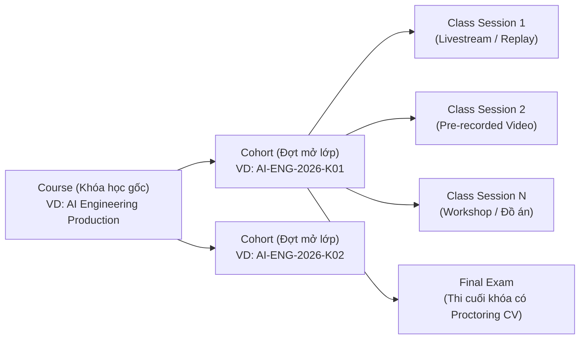
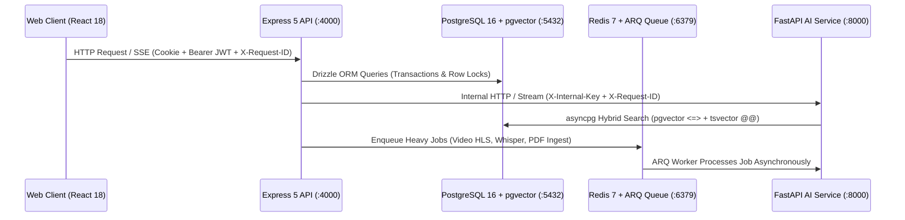

# 01. Kiến Trúc Tổng Thể & 12 Quyết Định Nghiệp Vụ Cốt Lõi (EduTech AI Platform v2)

> **Tài liệu này là nguồn sự thật duy nhất (Single Source of Truth) về mô hình kinh doanh, phân quyền, luồng nghiệp vụ và kiến trúc hệ thống.** Mọi kỹ sư và AI Coding Agent trước khi viết code cho Frontend, Backend hay AI Service đều bắt buộc phải đọc và tuân thủ nghiêm ngặt tài liệu này.

---

## 1. Mục Tiêu Dự Án & Chiến Lược Tái Kiến Trúc Phòng Sạch (Clean-Room Re-architecture)

Dự án **EduTech AI Platform v2** (`d:\Lap_Trinh_ST\web\edutech-ai-platform`) được xây dựng mới hoàn toàn từ con số 0 nhằm thay thế hệ thống cũ (`d:\Lap_Trinh_ST\web\Dự_án_CNPM` - 47 bảng rời rạc, pha trộn chợ khóa học Udemy và lớp học trực tiếp).

### Nguyên tắc kế thừa:
- **Dự án cũ (`Dự_án_CNPM`)** được giữ nguyên vẹn 100% ở thư mục bên cạnh để làm **Kho tham chiếu thuật toán (Reference Repository)** và bản dự phòng (Fallback).
- **Dự án mới (`edutech-ai-platform`)** chuẩn hóa toàn bộ bằng TypeScript `strict`, Drizzle ORM, PostgreSQL 16 + `pgvector` (33 bảng chuẩn 3NF), Redis 7 + `ARQ` Worker, FastAPI Python 3.12 và React 18 Feature-Sliced Design.

---

## 2. Mô Hình Kinh Doanh Cốt Lõi: Học Viện Tổ Chức (First-Party Live Cohort Academy)

Hệ thống **KHÔNG PHẢI** là chợ khóa học tự do kiểu Udemy (nơi giảng viên tự tạo tài khoản, tự đăng bán khóa học lẻ, có giỏ hàng, ví giảng viên rút tiền).
Ngược lại, hệ thống vận hành theo mô hình **Học viện Đào tạo Trực tuyến do Tổ chức Quản lý (First-Party Cohort Academy)**:

1. **`Course` (Khóa học gốc):** Là môn học/chương trình đào tạo lâu dài của Học viện. Gắn với **Chuẩn kỹ năng đầu vào (`PREREQUISITE`)** và **Chuẩn kỹ năng đầu ra (`LEARNING_OUTCOME`)** từ Từ điển Kỹ năng (`skills`). Có khung chương trình mẫu (`syllabus_template`).
2. **`Cohort` (Đợt khai giảng / Lớp học):** Là một đợt mở lớp cụ thể của một `Course` (ví dụ: Khóa K01 mở tháng 11/2026, Khóa K02 mở tháng 03/2027). Mỗi `Cohort` có học phí (`tuition_vnd`), sĩ số tối đa (`max_students`), cửa sổ mở/đóng đăng ký (`enrollment_open_at`, `enrollment_close_at`), đội ngũ giảng viên/trợ giảng riêng và danh sách buổi học riêng. **Học viên đăng ký và thanh toán trực tiếp cho từng `Cohort`**.
3. **`ClassSession` (Buổi học):** Là đơn vị học tập duy nhất bên trong một `Cohort`. Một buổi học có thể là:
   - **Buổi học Livestream trực tiếp** qua phòng WebRTC LiveKit (sau khi kết thúc sẽ được xử lý thành bản ghi phát lại `REPLAY_READY`).
   - **Buổi học dùng Video quay sẵn chất lượng cao** (được xem như học liệu chính của buổi học đó, dùng cho các buổi lý thuyết nền tảng hoặc buổi học bổ sung/bonus).
   - Mỗi buổi học đi kèm: Tài liệu đính kèm (PDF, slides, zip code), Phụ đề đồng bộ (`.vtt`), Bản tóm tắt AI (`ai_summary_md`), Thảo luận gắn mốc thời gian video (`discussion_threads`), và Bài tập thực hành của buổi (`SESSION_ASSIGNMENT`).

---

## 3. Ma Trận Phân Quyền 3 Tầng Rõ Ràng

### 3.1. Vai trò Tài khoản Hệ thống (`accounts.role`)
- **`STUDENT` (Học viên):** Tự đăng ký qua Email/Password hoặc Google OAuth 1-Tap. Học tập, xem livestream/replay, làm bài tập, chạy code trong Code Lab, hỏi đáp với AI Tutor, thi cuối khóa và nhận chứng chỉ.
- **`INSTRUCTOR` (Giảng viên / Trợ giảng / Chuyên gia):** Do Admin tạo tài khoản và gửi thư mời (không tự đăng ký ngoài trang công khai).
- **`ADMIN` (Ban Tổ Chức / Quản trị viên Học viện):** Đại diện cho Tổ chức. Quản lý danh mục, từ điển kỹ năng, khóa học, mở đợt học (`Cohort`), phân công giảng viên, đổi người dạy thay, chạy AI xếp lịch tự động, duyệt cấp/thu hồi chứng chỉ, giám sát chi phí AI.

### 3.2. Phân hạng Giảng viên (`instructor_profiles.tier`)
- **`STAFF` (Giảng viên / Trợ giảng cơ hữu của công ty):** Có khai báo khung giờ rảnh (`instructor_availabilities`) và được thuật toán AI Scheduler tự động xếp lịch dạy (`is_schedulable_by_ai = TRUE`).
- **`GUEST` (Chuyên gia khách mời từ doanh nghiệp):** Chỉ đứng lớp một số buổi chuyên đề cố định. Mặc định `is_schedulable_by_ai = FALSE` để thuật toán AI không tự ý xê dịch lịch của khách mời.

### 3.3. Vai trò Nhân sự bên trong một Đợt học (`cohort_instructors.role_in_cohort`)
- **`INSTRUCTOR` (Giảng viên chính của lớp):** Toàn quyền giảng dạy, mở phòng LiveKit, đăng/sửa tài liệu, tạo đề thi, chấm bài, xem toàn bộ học viên và phân tích sư phạm của đợt học.
- **`TA` (Trợ giảng của lớp):** Có quyền tương đương Giảng viên trong phạm vi hỗ trợ lớp học: được phép chủ trì buổi học (dạy phụ đạo, chữa bài tập, hoặc dạy thay khi được gán làm Host), đăng tài liệu, chấm bài, xác nhận câu trả lời thảo luận.
- **`GUEST` (Diễn giả khách mời trong lớp):** Chỉ nhìn thấy và thao tác trên đúng các buổi học (`class_sessions`) mà họ được chỉ định làm `host_instructor_id`. Không nhìn thấy bảng điểm hay danh sách học viên toàn khóa.

---

## 4. Mười Hai (12) Quyết Định Nghiệp Vụ & Kỹ Thuật Đã Chốt

### Quyết định 1: Xác thực Tinh gọn (Bỏ Facebook & GitHub Login)
- Chỉ hỗ trợ **Email + Mật khẩu (băm Argon2id)** và **Google OAuth 2.0 (1-Tap)**.
- Cơ chế liên kết tự động: Nếu học viên đã tạo tài khoản bằng Email rồi sau đó bấm "Tiếp tục với Google" có cùng địa chỉ Email đã xác thực, hệ thống tự động liên kết (`account_identities`) vào cùng một tài khoản `accounts`.
- Bảo mật phiên: `Access Token` (JWT 15 phút) chỉ lưu trong RAM của trình duyệt; `Refresh Token` lưu trong `HttpOnly, Secure, SameSite=Lax Cookie` có cơ chế xoay vòng (Token Rotation).

### Quyết định 2: Thanh toán Trực tiếp Đợt học (Bỏ Giỏ hàng, Ví Giảng viên & Mã Ghi danh Muộn)
- Học viên chọn Đợt học (`Cohort`) -> Đi thẳng tới trang Checkout (`/checkout/:cohortCode`) -> Thanh toán qua **VNPay** bằng đồng **VND**. Không giỏ hàng, không coupon phức tạp.
- Tích hợp khóa lũy đẳng (`idempotency_key`) khi tạo đơn và khóa nguyên tử (`SELECT ... FOR UPDATE`) khi nhận Webhook IPN từ VNPay để chống cộng đúp `enrolled_count` hoặc tạo 2 bản ghi `enrollments`.
- **Loại bỏ Mã ghi danh muộn (`late_join_code`):** Giữ trang thanh toán tinh gọn tối đa. Khi học viên có nhu cầu vào học sau khi lớp đã đóng đăng ký, họ liên hệ trực tiếp Ban tổ chức; Admin chỉ cần thao tác thêm học viên thủ công vào đợt học hoặc nới hạn `enrollment_close_at`.
- **Quy trình Mở lớp Mặc định (Phương án Tinh gọn Core):** Đợt học mở theo lịch trình bình thường (`DRAFT` → `OPENING` → `ONGOING` → `COMPLETED`). Kể cả khi số lượng ghi danh đạt 20%–30% chỉ tiêu, lớp vẫn được tiến hành bình thường để phục vụ nhóm học viên tiên phong, ghi nhận dữ liệu âm thanh/video bản ghi và kiểm thử AI mà không cài cắm các thủ tục hủy lớp/gộp lớp/hoàn tiền tự động phức tạp gây phình to hệ thống.

### Quyết định 3: Cơ chế Dạy Thay 1-Click Tinh Gọn (Không Workflow Phê Duyệt Rườm Rà)
- Giảng viên đều là nhân sự/đối tác nội bộ của Học viện, việc nhờ dạy thay được trao đổi nhanh bên ngoài rồi báo cho Admin.
- **Không xây dựng** bảng yêu cầu dạy thay hay máy trạng thái chờ duyệt nhiều bước gây nghẽn lịch học.
- Trên bảng `class_sessions`, chỉ sử dụng 3 cột:
  1. `host_instructor_id`: Người trực tiếp đứng lớp thực tế và **có quyền khởi động phòng LiveKit**.
  2. `original_host_id`: Người được phân công ban đầu trên lịch gốc (lưu vết khi có đổi người dạy).
  3. `substitution_reason`: Ghi chú ngắn (VD: *"Thầy B dạy thay Thầy A do Thầy A công tác"*).
- Khi Admin đổi Host của buổi học sang Giảng viên B: Hệ thống kiểm tra trùng lịch bằng ràng buộc `EXCLUDE USING gist`, lưu `original_host_id = A`, gán `host_instructor_id = B` và bắn thông báo cho học viên. Giảng viên B lập tức thấy nút "Bắt đầu Livestream" trên Dashboard.

### Quyết định 4: Chỉnh sửa Nội dung Buổi học Trực tiếp (In-place Update)
- Không tạo bản nháp phân nhánh phức tạp cho từng buổi học. Giảng viên/Admin chỉnh sửa trực tiếp tiêu đề, mô tả, tài liệu đính kèm trên buổi học và hệ thống ghi vết `last_updated_by`, `updated_at`.
- Riêng theo từng năm/kỳ mở lớp, vì mỗi `Cohort` sở hữu các dòng `class_sessions` riêng (sinh ra từ `syllabus_template` khi mở lớp), nên việc sửa nội dung buổi học của Khóa 2027 hoàn toàn độc lập, không làm hỏng lịch sử học tập của học viên Khóa 2026.

### Quyết định 5: Quản lý Video Quay Sẵn Như Một Học Liệu Của Buổi Học
- Với các buổi học không cần phát trực tiếp, Giảng viên tải lên tệp Video quay sẵn.
- Hệ thống tự động đưa video qua pipeline nền (`ARQ Worker`):
  1. Chuyển mã sang định dạng **HLS phân đoạn (`.m3u8` + `.ts`) có mã hóa AES-128** lưu trên Cloudflare R2.
  2. Chạy `Silero VAD` + `faster-whisper` sinh tệp phụ đề `.vtt` tiếng Việt và bóc tách các phân đoạn văn bản kèm mốc thời gian (`start_sec`, `end_sec`).
  3. Tạo vector embedding (`vector(1024)`) và lưu vào bảng `knowledge_chunks` gắn với `session_id`.
- **Khi Giảng viên thay thế video mới cho buổi học:** Hệ thống xóa các `knowledge_chunks` có `source_type = 'VIDEO_TRANSCRIPT'` của `session_id` cũ và lập chỉ mục lại từ video mới, đảm bảo AI Tutor không bao giờ trả lời kiến thức cũ đã bị thay thế.

### Quyết định 6: Luồng Xử lý Bản ghi Livestream & Lọc Livestream Thử Nghiệm (< 5 phút)
- Khi Giảng viên bấm kết thúc phòng LiveKit:
  - Nếu thời lượng thực tế (`actual_ended_at - actual_started_at`) **nhỏ hơn 5 phút (300 giây)**: Hệ thống tự động coi đây là phiên mở thử nghiệm thiết bị (test stream), không đưa vào hàng đợi chuyển mã Replay và không nạp vào RAG.
  - Nếu thời lượng **từ 5 phút trở lên**: Chuyển trạng thái buổi học sang `PROCESSING_REPLAY`, cắt HLS AES-128, tạo phụ đề `.vtt`, sinh bản tóm tắt AI (`ai_summary_md`) và 5 câu hỏi ôn tập nháp. Giảng viên bấm **"Duyệt xuất bản & Nạp AI"** để chuyển sang `REPLAY_READY`.

### Quyết định 7: Bảo vệ Bản quyền Video 3 Lớp (Anti-Piracy)
1. **Cloudflare R2 Private Bucket + Presigned URL ngắn hạn.**
2. **HLS AES-128 Encryption:** Khóa giải mã 16-byte chỉ được trả về qua API xác thực quyền `enrollments` của học viên.
3. **Dynamic Canvas Watermark:** Trình phát video trên trình duyệt vẽ lớp phủ `email + short_id` di chuyển ngẫu nhiên mỗi 12 giây (kể cả khi bật Fullscreen) và có `MutationObserver` tự động khôi phục nếu học viên mở F12 xóa node DOM.

### Quyết định 8: Hệ thống Khảo thí 7 Dạng Câu Hỏi & Chấm Điểm Kép (Auto + Manual + AI Draft)
- Hỗ trợ 7 dạng câu hỏi: `SINGLE_CHOICE`, `MULTI_SELECT`, `TRUE_FALSE`, `SHORT_ANSWER`, `ESSAY`, `FILE_SUBMISSION` (bao gồm cả thu âm giọng nói), và `CODING`.
- **Bảo mật tuyệt đối đề thi:** Bảng `assessment_items` tách `prompt_config` (hiển thị cho học viên) và `grading_config` (đáp án đúng, test case ẩn, rubric chấm điểm). API dành cho học viên tuyệt đối không bao giờ `SELECT grading_config`.
- **Chấm điểm kép:** Các câu trắc nghiệm và code có test case được chấm tự động (`AUTO_GRADED`). Các câu tự luận, nộp file, hoặc đánh giá phong cách code được chuyển vào hàng đợi chấm tay (`PENDING_MANUAL`) kèm **gợi ý điểm và nhận xét nháp từ AI (`ai_suggestion`)** để Giảng viên duyệt 1 chạm.

### Quyết định 9: Code Lab, Sandbox Không Trạng Thái & Inline Code Review
- Học viên có môi trường thực hành lập trình với **Monaco Editor** (Python, JS/TS, Java, C++, SQL).
- Thực thi code qua endpoint không lưu trạng thái `POST /api/v1/code/run` (chạy trong sandbox cô lập có giới hạn thời gian 5s và bộ nhớ). Các tệp nháp cá nhân (Scratchpads) lưu tại `localStorage` của trình duyệt.
- Khi chấm bài tập `CODING`, Giảng viên và AI có thể gắn nhận xét trực tiếp vào từng dòng code thông qua cột `submission_answers.review_comments JSONB` (`[{line, body, author, isAiDraft}]`).

### Quyết định 10: Từ Điển Kỹ Năng Chuẩn Hóa (`skills`) & Hệ Gợi Ý 2 Tầng (2-Tier RecSys)
- Mọi khóa học và mọi câu hỏi bài tập đều gắn với mã kỹ năng chuẩn trong bảng `skills`.
- Điểm làm chủ kỹ năng của học viên (`student_skill_states.mastery_score` từ `0.0` đến `1.0`) được cập nhật tự động sau mỗi lần nộp bài tập/thi.
- **Tầng 1 (Macro RecSys - Gợi ý khóa học kế tiếp theo ZPD):** Đề xuất khóa học mà học viên đã đạt $\ge 75\%$ kỹ năng tiên quyết (`PREREQUISITE`) nhưng chưa nắm vững kỹ năng đầu ra (`LEARNING_OUTCOME`), kèm lời giải thích minh bạch.
- **Tầng 2 (Micro RecSys - Lộ trình ôn tập chính xác tới từng giây video):** Ngay sau khi nộp bài kiểm tra, với các câu làm sai, hệ thống truy vấn vector để chỉ ra đúng **Buổi học + Khoảng thời gian video (`mm:ss - mm:ss`) + Trang tài liệu PDF** mà giảng viên đã giảng về khái niệm đó để học viên bấm vào xem lại ngay.

### Quyết định 11: Kho Tri Thức Hybrid RAG Cô Lập Theo Quyền Truy Cập
- Bảng `knowledge_chunks` kết hợp **Tìm kiếm Vector (`pgvector` HNSW)** + **Tìm kiếm Từ khóa (`tsvector` GIN)** + **Reciprocal Rank Fusion (RRF)** + **Cross-Encoder Reranker**.
- Phân tách cứng bằng cột `visibility`:
  - `PUBLIC`: Dùng cho Trợ lý Tư vấn Tuyển sinh (`/advisor`) ngoài trang chủ, kết hợp với dữ liệu thời gian thực (học phí, số chỗ trống, lịch khai giảng).
  - `ENROLLED_ONLY`: Chỉ truy xuất các chunk thuộc `cohort_id` mà học viên đã ghi danh hợp lệ. Mọi câu trả lời đều trả về mảng `citations` bấm được để nhảy tới đúng giây video hoặc trang PDF.

### Quyết định 12: Giám sát Thi Cử Computer Vision 2 Tầng (Edge MediaPipe + Server ONNX)
- Chỉ kích hoạt ở kỳ thi cuối khóa (`FINAL_EXAM`) để bảo vệ giá trị của Chứng chỉ mà không gây áp lực ở các bài tập hàng ngày.
- **Tầng 1 (Trình duyệt - Edge):** Chạy MediaPipe nhẹ nhàng phát hiện mất khuôn mặt (`NO_FACE`), nhiều người (`MULTI_FACE`), quay đầu lâu (`HEAD_TURNED`), chuyển tab (`TAB_HIDDEN`), thoát toàn màn hình (`FULLSCREEN_EXIT`).
- **Tầng 2 (Máy chủ - Server):** Chỉ khi Tầng 1 phát hiện bất thường kéo dài, trình duyệt mới chụp 1 ảnh JPEG nhẹ gửi lên AI Service để chạy **YOLO11n ONNX** (phát hiện điện thoại/tài liệu) và **ArcFace ONNX** (đối sánh với ảnh khuôn mặt gốc lúc Onboarding).
- **Quyền phán quyết thuộc về con người:** AI chỉ tính điểm rủi ro (`total_risk_score`) và gắn cờ `FLAGGED`. Giảng viên xem lại dòng thời gian bằng chứng để đưa ra kết luận cuối cùng (`CLEAN`, `CONFIRMED_CHEAT`, hoặc `CLEARED_BY_INSTRUCTOR`).

---

## 5. Kiến Trúc Giao Tiếp Liên Dịch Vụ (Inter-Service Architecture)

- **Quy tắc bảo mật mạng nội bộ:** Trình duyệt (`apps/web`) **chỉ** giao tiếp với `apps/api` (Port 4000). Trình duyệt không bao giờ gọi trực tiếp sang `apps/ai-service` (Port 8000) hay gọi trực tiếp Gemini API. Mọi yêu cầu từ `apps/api` sang `apps/ai-service` đều phải đính kèm header `X-Internal-Key` được kiểm tra bằng `hmac.compare_digest` và truyền xuyên suốt mã vết `X-Request-ID`.

