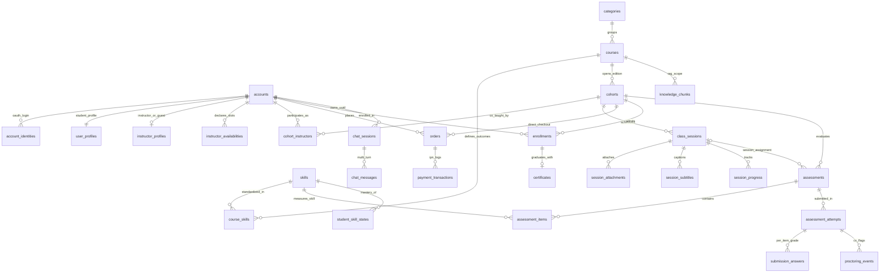

# 02. Thiết Kế Cơ Sở Dữ Liệu PostgreSQL 16 + `pgvector` (33 Bảng Chuẩn Hóa)

> **File SQL DDL gốc:** `apps/api/src/db/migrations/0000_baseline_v2.sql`  
> **Định nghĩa Drizzle ORM:** `apps/api/src/db/schema/`

---

## 1. Tổng Quan 6 Miền Nghiệp Vụ (33 Bảng Liên Kết Nhất Quán)

| Miền (Domain) | Số bảng | Danh sách bảng cụ thể | File Drizzle Schema |
| :--- | :---: | :--- | :--- |
| **1. Định danh, Google OAuth, Giảng viên & Khách mời** | `5` | `accounts`, `account_identities`, `user_profiles`, `instructor_profiles`, `instructor_availabilities` | `src/db/schema/identity.ts` |
| **2. Từ điển Kỹ năng, Khóa học & Buổi học (Cohort Live)** | `9` | `categories`, `skills`, `courses`, `course_skills`, `cohorts`, `cohort_instructors`, `class_sessions`, `session_attachments`, `session_subtitles` | `src/db/schema/catalog.ts`, `src/db/schema/cohort.ts` |
| **3. Ghi danh, Thanh toán VNPay, Tiến độ & Chứng chỉ** | `6` | `orders`, `payment_transactions`, `enrollments`, `session_progress`, `course_reviews`, `certificates` | `src/db/schema/commerce.ts` |
| **4. Thảo luận theo mốc giờ (có AI gợi ý) & Thông báo** | `3` | `discussion_threads`, `discussion_posts`, `notifications` | `src/db/schema/discussion.ts` |
| **5. Bài tập Đa dạng, Chấm điểm Kép, Code Review & Giám sát Thi CV** | `5` | `assessments`, `assessment_items`, `assessment_attempts`, `submission_answers`, `proctoring_events` | `src/db/schema/assessment.ts` |
| **6. Kho Vector Hybrid RAG, Năng lực Kỹ năng, Chat AI & Cấu hình** | `5` | `knowledge_chunks`, `student_skill_states`, `chat_sessions`, `chat_messages`, `system_settings` | `src/db/schema/ai_rag.ts`, `src/db/schema/system.ts` |

---

## 2. Sơ Đồ Quan Hệ Thực Thể (ERD)



---

## 3. Giải Thích Chi Tiết Các Thiết Kế Bảng Trọng Yếu

### 3.1. Bảng `class_sessions` — Trái tim của Mô hình Cohort Live & Video Quay Sẵn
- **Quản lý Giảng viên chủ trì & Lịch học Tinh gọn:**
  - `host_instructor_id`: Giảng viên thực tế đứng lớp và được cấp quyền mở phòng LiveKit (nếu mời diễn giả ngoài thì sinh LiveKit Guest Token dùng 1 lần qua `createGuestSpeakerToken` mà không cần tạo tài khoản DB).
  - `scheduled_start`, `scheduled_end`: Lịch của buổi học (có thể `NULL` đối với buổi học bổ sung hoàn toàn bằng video quay sẵn; khi giảng viên bận chỉ cần dời `scheduled_start/end`).
- **Khóa cứng chống trùng lịch giảng viên ở tầng CSDL (`EXCLUDE USING gist`):**
  ```sql
  EXCLUDE USING gist (
      host_instructor_id WITH =,
      tstzrange(scheduled_start, scheduled_end, '[)') WITH &&
  ) WHERE (scheduled_start IS NOT NULL AND scheduled_end IS NOT NULL)
  ```
  Ràng buộc này đảm bảo **cùng một giảng viên không bao giờ bị xếp dạy 2 buổi chồng lấn giờ nhau**, trong khi 2 đợt học khác giảng viên vẫn mở lớp cùng khung giờ tối hoàn toàn thoải mái.

### 3.2. Bảng `assessment_items` & `submission_answers` — Khảo Thí 6 Dạng (Trắc nghiệm + Tự luận/Dự án) & AI Co-Grader
- **`assessment_items`:**
  - Hỗ trợ 6 dạng câu hỏi tinh gọn: `SINGLE_CHOICE`, `MULTI_SELECT`, `TRUE_FALSE`, `SHORT_ANSWER`, `ESSAY` (bài viết Markdown, dán code, link GitHub), và `FILE_SUBMISSION` (tệp `.zip`, `.pdf`...).
  - Mỗi câu hỏi bắt buộc gắn với `skill_id REFERENCES skills(id)` để tự động cập nhật năng lực học viên (`student_skill_states`) sau khi chấm.
  - **`prompt_config JSONB`**: Chứa nội dung đề bài, các lựa chọn trắc nghiệm (không có cờ đáp án), hướng dẫn nộp bài tự luận/dự án.
  - **`grading_config JSONB`**: Chứa đáp án đúng và barem chấm tự luận/code (`rubric`). **Cột này tuyệt đối không bao giờ được trả về cho trình duyệt của học viên.**
- **`submission_answers`:**
  - Hỗ trợ quy trình chấm kép: `auto_score` (máy chấm trắc nghiệm trong 5ms), `manual_score` (giảng viên chốt điểm), `final_score` (điểm cuối cùng), và **`ai_suggestion JSONB`** (điểm gợi ý + nhận xét chi tiết theo Rubric do AI Co-Grader `LLM-as-a-Judge` sinh tự động để giảng viên duyệt 1 chạm).
- **`session_progress` (Hoàn thành buổi học theo năng lực hiểu bài):**
  - Bỏ các cột đếm giây (`watched_seconds`, `attended_live_seconds`). Chỉ giữ `last_position_sec` để lưu vị trí xem video và `is_completed = TRUE` được kích hoạt tự động khi học viên vượt qua bài kiểm tra ngắn của buổi học (`SESSION_ASSIGNMENT`).

### 3.3. Bảng `knowledge_chunks` — Kho Tri Thức Hybrid Search (Vector + Full-Text)
- Lưu trữ mọi đoạn tri thức từ:
  1. Bản ghi lời giảng video (`VIDEO_TRANSCRIPT`) kèm mốc thời gian `start_sec`, `end_sec`.
  2. Tài liệu PDF/Slide/DOCX đính kèm buổi học (`ATTACHMENT_DOC`) kèm số trang `page_number`.
  3. Tài liệu tư vấn tuyển sinh/hỏi đáp công khai (`FAQ`).
- Sở hữu đồng thời 2 chỉ mục tăng tốc:
  - `idx_chunks_embedding_hnsw` trên cột `embedding vector(1024)` (phục vụ tìm kiếm ngữ nghĩa Cosine Similarity `<=>`).
  - `idx_chunks_search_tsv_gin` trên cột `search_tsv tsvector` (phục vụ tìm kiếm chính xác tên hàm, mã lỗi, thuật ngữ kỹ thuật `@@`).

---

## 4. Năm (5) Quy Tắc Truy Vấn Bắt Buộc Cho Developer & AI Agent

1. **Quy tắc Chống Lộ Đáp Án:** Khi viết API lấy đề bài cho học viên (`GET /api/v1/assessments/:id/attempts/:attemptId`), câu lệnh `SELECT` trên bảng `assessment_items` chỉ được lấy `id, item_order, item_type, skill_id, points, prompt_config`. Cấm `SELECT *` hoặc trả về `grading_config` và `explanation_md` trước khi bài thi hoàn tất.
2. **Quy tắc Cô Lập Tri Thức RAG:** Khi học viên chat với `SESSION_TUTOR`, câu truy vấn vào `knowledge_chunks` bắt buộc phải kiểm tra học viên có bản ghi `enrollments` trạng thái `ACTIVE` hoặc `COMPLETED` trong `cohort_id` đó, và lọc `WHERE cohort_id = $1`.
3. **Quy tắc Chống Gian Lận Phiên Chat:** Trình duyệt chỉ gửi `chatSessionPublicId` (UUID) và nội dung câu hỏi mới. Backend phải kiểm tra `chat_sessions.account_id = req.user.id` (nếu sai trả về `404 Not Found`) và tự đọc lịch sử hội thoại từ DB, không tin tưởng mảng `history` do client gửi lên.
4. **Quy tắc Giao Dịch Thanh Toán Nguyên Tử:** Khi xử lý Webhook IPN từ VNPay, bắt buộc mở Transaction:
   - `SELECT * FROM orders WHERE order_code = $1 FOR UPDATE;`
   - Kiểm tra nếu `status = 'PAID'` thì dừng ngay và trả mã thành công (Idempotent).
   - Kiểm tra khớp tuyệt đối `amount_vnd`.
   - Cập nhật `orders.status = 'PAID'`, chèn `payment_transactions`, chèn `enrollments`, và cộng `cohorts.enrolled_count = enrolled_count + 1` trong cùng một Transaction.
5. **Quy tắc Thay Thế Video Buổi Học:** Khi giảng viên tải lên video mới thay thế video cũ của một `class_sessions`, Worker bắt buộc chạy `DELETE FROM knowledge_chunks WHERE session_id = $1 AND source_type = 'VIDEO_TRANSCRIPT'` trước khi chèn các chunk của video mới.

