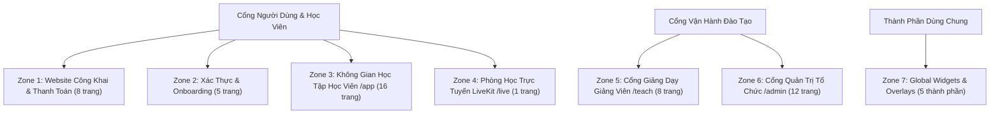

# ĐẶC TẢ CHỨC NĂNG TOÀN DIỆN FRONTEND (SRS FRONTEND)
## Nền Tảng Đào Tạo Công Nghệ Trực Tuyến (EduTech AI Platform)

---

## PHẦN I: TỔNG QUAN CHUYỂN DỊCH & RÀNG BUỘC KỸ THUẬT

### 1.1. So Sánh Kiến Trúc Nghiệp Vụ: Hệ Thống Cũ vs Hệ Thống Mới

| Hạng mục | Hệ thống cũ | Hệ thống mới | Ràng buộc Frontend cần nhớ |
| :--- | :--- | :--- | :--- |
| **Mô hình kinh doanh** | Chợ khóa học mở (Udemy Marketplace) cho GV tự do đăng bán video lẻ. | **Học viện Tổ chức (Live Cohort Academy)**. Tổ chức sở hữu khóa học, chia thành các Đợt học (`Cohort`) theo kỳ/năm. | Học viên mua **Đợt học (`Cohort`)**, học theo lịch trình với Giảng viên và bạn cùng lớp. |
| **Đơn vị học tập** | Video bài giảng ghi sẵn cắt vụn. | **Buổi học (`Class Session`)**: Có thể là Buổi Livestream thực tế hoặc Buổi học dùng Video quay sẵn chất lượng cao làm học liệu. | Cùng 1 giao diện Buổi học quản lý thống nhất cả Live, Replay và Pre-recorded Video. |
| **Quy trình Mua hàng** | Giỏ hàng nhiều khóa, ví giảng viên, chia doanh thu %, mã giảm giá đại trà. | **Mua trực tiếp 1-Click (Direct Checkout)** qua VNPay. Không giỏ hàng, không ví GV, giá niêm yết theo Đợt. | Luồng mua đi thẳng: Bấm "Đăng ký" -> Trang Checkout -> Cổng VNPay -> Kích hoạt ghi danh tự động. |
| **Xác thực người dùng** | Email, Google, Facebook, GitHub rườm rà. | **Email/Mật khẩu (Argon2id) + Google OAuth 2.0 (1-Tap)**. Bỏ hoàn toàn Facebook & GitHub. | 3 vai trò tài khoản: `STUDENT`, `INSTRUCTOR`, `ADMIN`. Diễn giả khách mời tham gia qua **LiveKit Guest Link** dùng 1 lần. |
| **Bảo vệ Bản quyền Video** | Video upload thẳng lên server/S3, dễ bị tải lậu qua IDM/F12. | **Cloudflare R2 + HLS Mã hóa AES-128 + Dynamic Watermark Canvas** (Email + Short ID di chuyển ngẫu nhiên). | Trình phát video độc quyền có lớp watermark di chuyển mỗi 12s, chống inspect DOM, chặn chuột phải khu vực phát. |
| **Quản lý Lịch học & Giảng viên** | Không hỗ trợ hoặc quy trình xin phép/phê duyệt rườm rà dễ nghẽn lịch. | **Lịch học tinh gọn & Dời lịch nhanh**: Giảng viên bận -> dời lịch `scheduled_start/end` hoặc cập nhật `host_instructor_id`. | Kiểm tra chống trùng giờ tự động bằng `EXCLUDE USING gist`. |
| **Hệ thống AI tích hợp** | RAG cơ bản hoặc chatbot rời rạc, không gắn với mốc thời gian bài giảng. | **Bộ AI Đa phương thức gắn chặt với nghiệp vụ**: Hybrid RAG, Live Copilot, RecSys 2 tầng (ZPD + Video clip ôn tập), Giám sát thi CV 2 tầng, AI Scheduler, AI Co-Grader. | Mọi trích dẫn AI (`Citations`) trong bài giảng đều có thể click để nhảy đúng giây video (`seek(mm:ss)`) hoặc trang tài liệu PDF. |
| **Phân hệ Bài tập & Đánh giá** | Trắc nghiệm đơn giản, không có AI đánh giá tự luận/dự án. | **Khảo thí 6 dạng câu hỏi (Trắc nghiệm + Tự luận/Code/Link GitHub/Nộp File) + AI Quiz Generator + AI Co-Grader (`LLM-as-a-Judge`)**. | Học viên vượt qua bài kiểm tra ngắn của buổi học để xác nhận hoàn thành buổi học (`is_completed = true`). |

---

## PHẦN II: DANH MỤC CHI TIẾT CÁC TRANG & CHỨC NĂNG FRONTEND

Hệ thống được tổ chức thành **6 Phân hệ Giao diện chính** và **1 Nhóm Widget Dùng chung**:

---

### ZONE 1: WEBSITE CÔNG KHAI & THANH TOÁN (PUBLIC & MARKETING)

#### 1. Trang chủ Học viện (`GET /`)
* **Dữ liệu hiển thị:**
  * Khẩu hiệu định vị thương hiệu đào tạo công nghệ chuyên sâu.
  * Danh sách các đợt lớp sắp khai giảng gần nhất (`Cohorts` đang mở ghi danh): Tên khóa, mã đợt, ngày khai giảng, số buổi, số chỗ còn trống, học phí, hạn chót đăng ký.
  * Danh mục các chương trình đào tạo theo lĩnh vực (AI/Data, Backend/Cloud, Frontend, UI/UX, Kỹ năng công nghệ).
  * Lộ trình học tập mẫu: *Học trực tiếp với chuyên gia -> Xem lại bản ghi & bài tập thực chiến -> Thi năng lực có giám sát -> Nhận chứng chỉ số có mã xác thực*.
  * Đội ngũ Giảng viên nòng cốt và Chuyên gia khách mời từ doanh nghiệp.
  * Đánh giá thực tế từ học viên đã tốt nghiệp (kèm mã đợt học đã tham gia).
  * Khối câu hỏi thường gặp (FAQ) dạng Accordion.
* **Chức năng & Tác vụ:**
  * Tìm kiếm nhanh khóa học theo từ khóa hoặc công nghệ.
  * Lọc nhanh lớp học theo tháng khai giảng hoặc cấp độ.
  * Nút mở Trợ lý AI Tư vấn Khóa học (`/advisor`).
  * Nút "Đăng ký ngay" trên từng thẻ đợt học -> chuyển hướng đến Trang Chi tiết hoặc Checkout.

#### 2. Trang Danh mục & Tìm kiếm Khóa học (`GET /courses`)
* **Dữ liệu hiển thị:**
  * Lưới/Danh sách các khóa học hiện có của Học viện.
  * Bộ lọc đa chiều bên thanh bên (Sidebar): Cây danh mục, Cấp độ khó (1–5), Kỹ năng đầu ra (Skill tags), Trạng thái ("Đang mở lớp ghi danh"), Khoảng học phí.
  * Thanh tìm kiếm có gợi ý kỹ năng tương ứng (Auto-suggest).
  * Tổng số kết quả phù hợp và công cụ sắp xếp (Mới nhất, Đánh giá cao nhất, Lớp sắp mở gần nhất).
* **Chức năng & Tác vụ:**
  * Tìm kiếm tức thì với cơ chế Debounce.
  * Lọc đa tiêu chí, đồng bộ trạng thái bộ lọc lên URL Query Parameters (hỗ trợ copy link gửi cho bạn bè).
  * Chuyển đổi giữa chế độ xem Lưới (Grid) và Danh sách (List).
  * Trạng thái danh sách rỗng (Empty state) kèm nút "Xóa tất cả bộ lọc".

#### 3. Trang Chi tiết Khóa học & Đợt khai giảng (`GET /courses/:slug`)
* **Dữ liệu hiển thị:**
  * Tiêu đề khóa, danh mục, cấp độ, số giờ đào tạo, điểm đánh giá trung bình.
  * Video giới thiệu khóa học (Nhúng từ YouTube Public) hoặc video bài học xem trước miễn phí.
  * Phần giới thiệu tổng quan và mục tiêu khóa học (định dạng Markdown).
  * **Chuẩn kỹ năng**: Thẻ kỹ năng cần có trước (Prerequisites) và Kỹ năng đạt được sau khóa học (Learning Outcomes). *Nếu học viên đã đăng nhập, hệ thống hiển thị chỉ số sẵn sàng (% đáp ứng kỹ năng đầu vào dựa trên hồ sơ học viên)*.
  * Khung chương trình chuẩn (`Syllabus Template`): Danh sách các buổi học kèm nhãn hoạt động (`Lý thuyết`, `Thực hành Live Coding`, `Workshop`, `Review đồ án`).
  * **Bảng danh sách các Đợt học (`Cohorts`) đang hoặc sắp mở**:
    * Mã đợt (VD: `AI-ENG-2026-K01`), ngày bắt đầu - kết thúc, lịch học trong tuần (VD: T3 - T5 lúc 19:30).
    * Giảng viên chính và Trợ giảng phụ trách đợt.
    * Thanh trạng thái chỗ ngồi (VD: *Còn 7 / 30 chỗ*).
    * Cửa sổ đăng ký (Ngày mở - Ngày đóng). Trạng thái nút bấm: "Đăng ký đợt này", "Đã hết chỗ", hoặc "Đã đóng đăng ký".
  * Đánh giá chi tiết của học viên từ các đợt học trước (có lọc theo đợt).
* **Chức năng & Tác vụ:**
  * Học viên chọn đợt học mong muốn -> Thẻ thanh toán cố định (Sticky Sidebar trên Desktop / Bottom Bar trên Mobile) cập nhật thông tin và nút "Ghi danh ngay".
  * Cảnh báo xung đột lịch học: Nếu học viên đã đăng nhập và đang học 1 đợt khác có giờ học trùng với đợt đang chọn, hệ thống hiện cảnh báo màu vàng liệt kê các buổi bị trùng giờ (vẫn cho phép học viên tiếp tục nếu muốn).

#### 4. Trang Danh bạ & Hồ sơ Giảng viên (`GET /instructors` & `GET /instructors/:id`)
* **Dữ liệu hiển thị:**
  * Họ tên, danh hiệu chuyên môn, ảnh đại diện, đơn vị công tác hiện tại, số năm kinh nghiệm.
  * Nhãn phân định rõ ràng: Giảng viên Cơ hữu (`STAFF`) hoặc Chuyên gia Khách mời Doanh nghiệp (`GUEST`).
  * Tóm tắt tiểu sử chuyên môn và dự án thực tế.
  * Các liên kết mạng xã hội nghề nghiệp (LinkedIn, GitHub, Portfolio).
  * Danh sách các khóa học và đợt học mà giảng viên đang hoặc đã từng giảng dạy.
* **Chức năng & Tác vụ:**
  * Xem lịch sử giảng dạy và các đánh giá từ học viên.
  * Chuyển hướng xem các đợt học do giảng viên này phụ trách.

#### 5. Trang Trợ lý AI Tư vấn Khóa học & Lộ trình (`GET /advisor`)
* **Dữ liệu hiển thị:**
  * Giao diện hội thoại tương tác thông minh chuyên trách tư vấn tuyển sinh và định hướng nghề nghiệp.
  * Gợi ý các câu hỏi mở đầu nhanh (VD: *"Tôi muốn học AI từ con số 0 thì nên bắt đầu từ khóa nào?", "Lớp Backend tháng này còn chỗ không?"*).
  * Khối phản hồi của AI hỗ trợ định dạng Text kèm thẻ khóa học tương tác trực tiếp (Course Card hiển thị giá, số chỗ còn, lịch khai giảng lấy từ dữ liệu thời gian thực).
* **Chức năng & Tác vụ:**
  * Nhập câu hỏi, AI truyền dữ liệu phản hồi dạng luồng (Streaming SSE).
  * Bấm vào thẻ khóa học trong khung chat để chuyển sang trang chi tiết đợt học.
  * Lưu lịch sử hội thoại nếu đã đăng nhập; nếu chưa đăng nhập, hiển thị gợi ý đăng nhập để lưu trữ lộ trình học đã tư vấn.

#### 6. Trang Tra cứu & Xác thực Chứng chỉ Công khai (`GET /verify/:certificateCode`)
* **Dữ liệu hiển thị:**
  * Thông tin tra cứu chứng chỉ số bằng mã định danh duy nhất (VD: `CERT-2026-AI-89234`).
  * Trạng thái chứng chỉ: **Hợp lệ (Valid)**, **Đã bị thu hồi (Revoked)** kèm lý do thu hồi, hoặc **Không tìm thấy**.
  * Bản chứng chỉ điện tử đầy đủ: Tên học viên, tên khóa học, mã đợt học, chuẩn kỹ năng đạt được, ngày cấp, chữ ký số điện tử của Học viện, mã QR xác minh.
* **Chức năng & Tác vụ:**
  * Tải bản PDF chứng chỉ đạt chuẩn in ấn (sử dụng print stylesheet chuẩn).
  * Sao chép liên kết chia sẻ chứng chỉ lên LinkedIn hoặc hồ sơ xin việc cá nhân.

#### 7. Trang Thanh toán Trực tiếp Đợt học (`GET /checkout/:cohortCode`)
* **Dữ liệu hiển thị:**
  * Yêu cầu bắt buộc: Đã đăng nhập tài khoản học viên (nếu chưa, chuyển hướng sang Login và quay lại sau khi đăng nhập thành công).
  * Tóm tắt đơn hàng: Tên khóa học, Mã đợt học, Ngày khai giảng, Thời gian học hàng tuần, Học phí niêm yết (VND).
  * Hạn chót đăng ký đợt học (Enrollment Deadline Countdown).
  * Phương thức thanh toán duy nhất: **Cổng thanh toán Trực tuyến VNPAY (ATM Nội địa / Thẻ Quốc tế / QR Code Ngân hàng)**.
  * Điều khoản đăng ký học.
* **Chức năng & Tác vụ:**
  * Xác nhận điều khoản và bấm "Thanh toán qua VNPAY".
  * Hệ thống khởi tạo đơn hàng với khóa lũy đẳng (Idempotency Key chống tạo trùng đơn khi bấm nhiều lần) và chuyển hướng học viên sang Cổng thanh toán VNPAY.

#### 8. Trang Kết quả Giao dịch VNPay (`GET /checkout/result?order=...`)
* **Dữ liệu hiển thị:**
  * Trạng thái xử lý thanh toán theo thời gian thực (Polling trạng thái đơn hàng từ Backend):
    * **Thành công (`PAID`)**: Hiển thị bảng chúc mừng trang nhã, thông tin đợt học đã ghi danh, ngày bắt đầu buổi học đầu tiên, mã giao dịch VNPAY.
    * **Đang chờ xử lý (`PENDING`)**: Thông báo ngân hàng đang đối soát dữ liệu kèm đồng hồ chờ.
    * **Thất bại / Hết hạn (`FAILED` / `EXPIRED`)**: Giải thích lý do giao dịch không thành công.
* **Chức năng & Tác vụ:**
  * Khi thành công: Nút "Thêm lịch học vào Google Calendar / Outlook (.ics)" và nút "Vào Không Gian Lớp Học".
  * Khi thất bại: Nút "Thử lại thanh toán" (tạo phiên giao dịch mới nếu đợt học vẫn còn trong hạn đăng ký).

---

### ZONE 2: XÁC THỰC, BẢO MẬT & ONBOARDING

#### 9. Trang Đăng nhập (`GET /login`)
* **Thành phần & Chức năng:**
  * Form đăng nhập bằng Email và Mật khẩu.
  * Nút bấm nổi bật **"Tiếp tục với Google"** (Đăng nhập 1-Tap qua Google OAuth 2.0).
  * Chức năng "Ghi nhớ phiên đăng nhập".
  * Liên kết "Quên mật khẩu?" và "Chưa có tài khoản? Đăng ký ngay".
  * Xử lý lỗi bảo mật: Hiển thị thông báo thân thiện khi nhập sai thông tin hoặc tài khoản bị khóa tạm thời do nhập sai quá số lần quy định ("Vui lòng thử lại sau 60 giây").

#### 10. Trang Đăng ký Học viên (`GET /register`)
* **Thành phần & Chức năng:**
  * Form đăng ký: Họ và tên, Email, Mật khẩu, Xác nhận mật khẩu.
  * Thước đo độ mạnh mật khẩu trực quan (yêu cầu tối thiểu 8 ký tự, gồm chữ hoa, chữ thường và số).
  * Checkbox đồng ý Điều khoản dịch vụ và Chính sách bảo mật dữ liệu.
  * Đăng ký nhanh với tài khoản Google.
  * Sau khi gửi form: Hiển thị thông báo hướng dẫn kích hoạt tài khoản qua hộp thư điện tử.

#### 11. Trang Quên & Đặt lại mật khẩu (`GET /forgot-password` & `GET /reset-password/:token`)
* **Thành phần & Chức năng:**
  * Trang quên mật khẩu: Nhập Email để nhận liên kết khôi phục có hiệu lực trong 15 phút.
  * Trang đặt lại mật khẩu: Nhập mật khẩu mới, kiểm tra tính hợp lệ của token khôi phục (nếu token hết hạn, báo lỗi và hướng dẫn yêu cầu lại).

#### 12. Trang Xác thực Email Kích hoạt (`GET /verify-email`)
* **Thành phần & Chức năng:**
  * Tiếp nhận mã kích hoạt từ liên kết trong email.
  * Hiển thị trạng thái: Đang xác thực -> Kích hoạt thành công -> Tự động chuyển hướng vào Trang khảo sát Onboarding hoặc Dashboard học tập.
  * Nút "Gửi lại email kích hoạt" nếu liên kết cũ bị quá hạn.

#### 13. Khảo sát Năng lực & Đăng ký Khuôn mặt Ban đầu (`GET /onboarding`)
* **Mục đích:** Hướng dẫn học viên thiết lập hồ sơ cá nhân lần đầu sau khi đăng nhập (có thể bỏ qua và làm lại sau trong trang Cài đặt).
* **Các bước khảo sát (Stepper):**
  * **Bước 1 — Mục tiêu nghề nghiệp:** Chọn định hướng (Backend, AI Engineer, Data Analyst...) và trình độ hiện tại.
  * **Bước 2 — Đánh giá năng lực đầu vào (Diagnostic Quiz):** Trắc nghiệm thích ứng 5 câu hỏi ngắn để hệ thống đo lường mức độ thành thạo các kỹ năng nền tảng ban đầu.
  * **Bước 3 — Đăng ký Khuôn mặt Tham chiếu (Face Reference Capture):** 
    * Hướng dẫn học viên bật webcam, căn chỉnh khuôn mặt vào khung hình để chụp 1 ảnh chân dung gốc phục vụ việc đối soát danh tính khi tham gia các kỳ thi cuối khóa có giám sát (`AI Proctoring`).
    * Thông báo minh bạch về bảo mật dữ liệu sinh trắc học và cam kết lưu trữ an toàn.
  * **Bước 4 — Kết quả & Đề xuất:** Hiển thị radar kỹ năng ban đầu và gợi ý 3 khóa học phù hợp nhất với trình độ.

---

### ZONE 3: KHÔNG GIAN HỌC TẬP HỌC VIÊN (`/app`)

#### 14. Dashboard Tổng quan Học viên (`GET /app`)
* **Dữ liệu hiển thị:**
  * **Khu vực "Hôm nay có gì":** Các buổi học diễn ra trong ngày. Nếu buổi học đang diễn ra, hiển thị Banner trực tiếp kèm nhãn **"ĐANG LIVE"** nhấp nháy đỏ và nút bấm "Vào lớp ngay". Nếu sắp diễn ra trong vòng 60 phút, hiển thị đồng hồ đếm ngược.
  * **Tiếp tục học tập:** Buổi học xem gần nhất kèm thanh tiến độ và nút "Học tiếp" (tự động phát đúng vị trí giây dừng lại trước đó).
  * **Hạn nộp bài tập sắp tới:** Danh sách bài tập/kỳ thi sắp đến hạn nộp (đánh dấu đỏ cảnh báo nếu còn dưới 24h).
  * **Ảnh chụp Năng lực Kỹ năng (Skill Snapshot):** Radar thu nhỏ 8 kỹ năng cốt lõi và 3 kỹ năng còn yếu nhất kèm nút *"Ôn tập ngay"* (chuyển thẳng đến danh sách bài giảng/mốc video tương ứng).
  * **Chuỗi ngày học tập (Streak) & Nhiệt đồ hoạt động:** Biểu đồ hoạt động học tập hàng tuần/tháng.
  * **Đề xuất cá nhân hóa từ AI (AI Recommendations):** Gợi ý đợt học tiếp theo dựa trên chỉ số làm chủ kỹ năng (kèm lý do vì sao nên học).
  * Thông báo mới nhất từ Giảng viên và Quản trị viên.

#### 15. Danh sách Đợt học Đã đăng ký (`GET /app/learning`)
* **Dữ liệu hiển thị:**
  * Bộ lọc phân loại: "Đang học" (Active) và "Đã hoàn thành" (Completed).
  * Thẻ đợt học: Ảnh đại diện, Tên khóa, Mã đợt, Vòng tròn tiến độ hoàn thành (% buổi học đã tham gia/xem), Thông tin buổi học kế tiếp, Giảng viên phụ trách, Hạn chót truy cập bản ghi bài giảng (nếu có).
* **Chức năng:** Bấm vào thẻ để mở Không Gian Lớp Học chi tiết.

#### 16. Không Gian Lớp Học Toàn Diện (`GET /app/cohorts/:cohortId`)
Không gian học tập chính của một đợt học, bao gồm Header thông tin lớp và **6 Tab chức năng**:
* **Header đợt học:** Tên khóa, mã đợt, phiên bản giáo trình áp dụng, danh sách avatar Giảng viên & Trợ giảng, thanh tổng tiến độ học tập.
* **Tab 1: Buổi học (`Sessions`):**
  * Danh sách các buổi học xếp theo dòng thời gian dọc (Vertical Timeline), nhóm theo từng tuần.
  * Thông tin mỗi buổi: Thứ tự buổi, Tên bài giảng, Nhãn hoạt động (`Lý thuyết`, `Code Lab`, `Review`), Tên giảng viên đứng lớp *(nếu có dạy thay, hiển thị: "Thầy B - Dạy thay Thầy A")*.
  * Trạng thái buổi học:
    * `SCHEDULED`: Có lịch dự kiến, nút thêm vào lịch cá nhân.
    * `LIVE`: Đang phát sóng trực tiếp, nút vào phòng Live nổi bật.
    * `PROCESSING_REPLAY`: Trạng thái đang chuyển mã video sau buổi phát (Kèm thanh tiến độ: *Lưu trữ -> Chuyển mã HLS -> Tạo phụ đề -> Trích xuất AI*).
    * `REPLAY_READY`: Đã sẵn sàng video bản ghi kèm thời lượng (ví dụ: *01:45:20*).
    * *Đặc biệt*: Biểu tượng huy hiệu cho các buổi học dùng **Video quay sẵn chất lượng cao**.
  * Dấu tích xanh khi học viên đã học xong (đạt >= 90% thời lượng xem).
  * Số lượng tài liệu đính kèm và huy hiệu nếu có bài tập về nhà đính kèm buổi đó.
* **Tab 2: Lịch học (`Schedule`):**
  * Lịch học dạng Tuần/Tháng trực quan, hiển thị rõ giờ học từng buổi.
  * Chức năng tải toàn bộ lịch của đợt học về máy dưới dạng tệp `.ics`.
* **Tab 3: Bài tập & Thi (`Assessments`):**
  * Danh sách toàn bộ bài kiểm tra định kỳ theo buổi và bài thi cuối khóa của đợt học.
  * Trạng thái bài tập của học viên: *Chưa làm, Đang làm dở, Đã nộp - Chờ chấm, Đã có điểm, Quá hạn*.
  * Hạn nộp bài và điểm số đạt được trên thang điểm chuẩn.
* **Tab 4: Thảo luận chung (`Discussions`):**
  * Toàn bộ các chủ đề thảo luận trong đợt học, hỗ trợ lọc theo: *Chưa giải quyết, Có câu trả lời từ Giảng viên xác nhận, Bài đăng của tôi*.
* **Tab 5: Bảng điểm cá nhân (`Gradebook`):**
  * Bảng tổng hợp điểm số chi tiết từng bài tập, trọng số điểm thành phần, điểm thi cuối khóa và điều kiện nhận chứng chỉ.
* **Tab 6: Kho Học liệu Lớp học (`Materials`):**
  * Tập hợp toàn bộ slide bài giảng (PDF), tệp mã nguồn mẫu, đề bài thực hành của tất cả các buổi học, hỗ trợ tìm kiếm nhanh theo tên tệp.

#### 17. Phòng Xem Bài giảng Đa phương thức (`GET /app/cohorts/:cohortId/sessions/:sessionId`)
Trang học tập chuyên sâu được tối ưu hóa cho việc tiếp thu kiến thức và tương tác với AI:
* **Khu vực Trình phát Video An toàn (Bên trái / Phía trên):**
  * **Trình phát HLS Chống rò rỉ:** Hỗ trợ điều chỉnh chất lượng thích ứng (Auto, 1080p, 720p, 480p), tốc độ phát (0.5x đến 2x), bật/tắt phụ đề tiếng Việt.
  * **Lớp phủ Watermark Động (Dynamic Canvas Watermark):** Hiển thị mờ Email và ID học viên chạy ngẫu nhiên khắp khung hình video mỗi 12 giây, chống xóa qua DevTools.
  * Chặn menu chuột phải tại khu vực video; tự động lưu tiến độ học mỗi 15 giây; tự động đánh dấu hoàn thành buổi học khi học viên xem đạt 90%.
  * Phím tắt tiện lợi: Phím cách (Play/Pause), Phím J/L (Tua lùi/tiến 10s), Phím F (Toàn màn hình), Phím C (Bật phụ đề), Phím M (Tắt tiếng).
  * Các mốc đánh dấu chương bài học (Chapter markers) trích xuất tự động từ AI Summary.
* **Khu vực Bảng Thông Tin Tương Tác 5 Tab (Bên phải):**
  * **Tab 1 — Bản ghi lời giảng đồng bộ (`Transcript`):** Toàn bộ lời giảng được hiển thị thành văn bản đồng bộ theo từng giây video; dòng phụ đề đang nói tự động highlight và cuộn theo video; bấm vào bất kỳ câu nào để video nhảy ngay đến giây đó; có ô tìm kiếm từ khóa bên trong lời giảng.
  * **Tab 2 — Tóm tắt AI (`AI Summary`):** Bản tóm tắt các luận điểm cốt lõi, công thức, mã code tiêu biểu của buổi học được định dạng Markdown rõ ràng kèm nhãn cảnh báo: *"Nội dung do AI tổng hợp tự động"*.
  * **Tab 3 — Tài liệu đính kèm (`Attachments`):** Danh sách tệp đính kèm; xem trực tiếp tài liệu PDF ngay trong màn hình (Slide viewer) mà không cần tải về máy; nút tải tệp thực hành.
  * **Tab 4 — Thảo luận theo mốc thời gian (`Timestamped Discussion`):** Học viên đặt câu hỏi kèm checkbox *"Gắn mốc thời gian hiện tại mm:ss"*; hiển thị các câu trả lời dạng phân nhánh; đánh dấu nổi bật các câu trả lời do Giảng viên/Trợ giảng xác nhận (`Instructor Verified`) hoặc câu trả lời do AI gợi ý bản nháp (`AI Draft`).
  * **Tab 5 — Trợ giảng AI Riêng biệt (`Session Tutor Chat`):** Cửa sổ chat với AI được nạp toàn bộ tri thức của buổi học và tài liệu lớp; trả lời thắc mắc của học viên kèm trích dẫn nguồn có thể bấm được *(Click vào trích dẫn video để tua video đến giây tương ứng; click vào trích dẫn tài liệu để mở đúng trang PDF)*.
* **Khu vực Bên dưới Trình phát:** Tiêu đề buổi học, thông tin Giảng viên phụ trách, tóm tắt nội dung chi tiết, thẻ bài tập về nhà cần làm, nút chuyển nhanh sang Buổi trước / Buổi kế tiếp.

#### 18. Trang Giới thiệu & Bắt đầu Bài kiểm tra (`GET /app/assessments/:assessmentId`)
* **Dữ liệu hiển thị:** Tiêu đề bài tập / bài thi, đợt học tương ứng, loại bài tập (Bài tập buổi học hoặc Thi cuối khóa), hướng dẫn làm bài chi tiết, thời gian làm bài (phút), điểm đạt yêu cầu (% pass score), số lần làm bài cho phép / số lần đã sử dụng, hạn chót nộp bài, danh mục kỹ năng được đánh giá.
* **Chức năng:** Bảng lịch sử các lần làm bài trước (Điểm số, thời gian nộp, trạng thái chấm điểm); Nút "Bắt đầu làm bài" (kèm hộp thoại xác nhận thời gian đếm ngược).

#### 19. Phòng Làm bài Kiểm tra Trực tuyến (`GET /app/assessments/:assessmentId/attempts/:attemptId`)
* **Giao diện & Thành phần chức năng:**
  * **Header cố định:** Đồng hồ đếm ngược thời gian còn lại (chuyển sang màu đỏ cảnh báo ở 5 phút và 1 phút cuối); Chỉ báo lưu tự động ("Đã lưu lúc 20:15:30"); Nút nộp bài.
  * **Bảng điều hướng câu hỏi (Question Palette):** Lưới các câu hỏi với trạng thái màu sắc rõ ràng: *Đã trả lời, Chưa trả lời, Đang đánh dấu xem lại (Flagged)*.
  * **Hỗ trợ 6 dạng câu hỏi tiêu chuẩn (Trắc nghiệm + Tự luận/Dự án):**
    1. `SINGLE_CHOICE`: Trắc nghiệm 1 đáp án đúng (Radio cards lớn, dễ bấm).
    2. `MULTI_SELECT`: Trắc nghiệm nhiều đáp án đúng (Checkbox cards kèm chỉ dẫn *"Chọn tất cả đáp án đúng"*).
    3. `TRUE_FALSE`: Lựa chọn Đúng / Sai.
    4. `SHORT_ANSWER`: Điền từ/câu trả lời ngắn kèm bộ đếm ký tự.
    5. `ESSAY`: Trình soạn thảo văn bản tự luận Markdown (hỗ trợ viết bài phân tích, dán đoạn code hoặc đính kèm link GitHub Repository) kèm bộ đếm số từ.
    6. `FILE_SUBMISSION`: Khu vực kéo thả tệp đính kèm (hỗ trợ tệp bài tập `.zip`, báo cáo `.pdf`, hoặc tệp ghi âm giọng nói với trình thu âm tích hợp sẵn).
  * **Cơ chế an toàn kết nối mạng:** Tự động lưu bài tạm vào bộ nhớ trình duyệt nếu mất mạng và tự động đồng bộ lên máy chủ ngay khi có kết nối trở lại.
  * **Nộp bài:** Hộp thoại tổng kết số câu đã làm, số câu còn bỏ sót hoặc đang cắm cờ trước khi chính thức xác nhận nộp. Khi học viên vượt qua bài kiểm tra ngắn của buổi học (`SESSION_ASSIGNMENT`), buổi học đó tự động được đánh dấu Hoàn thành (`is_completed = TRUE`).

#### 20. Trang Kết quả Bài thi & Lộ trình Ôn tập AI (`GET /app/assessments/.../result`)
* **Dữ liệu hiển thị:**
  * Điểm số tổng kết, tỷ lệ phần trăm và kết quả Đạt / Chưa đạt (hoặc trạng thái *"Đang chờ giảng viên chấm điểm tự luận"*).
  * Xem lại chi tiết từng câu hỏi: Câu trả lời của học viên, tính đúng sai, lời giải chi tiết (nếu bài thi cho phép xem đáp án sau khi nộp), nhận xét từ Giảng viên.
  * **Phân tích thay đổi năng lực kỹ năng:** Bảng chỉ số đo lường mức độ thành thạo kỹ năng trước và sau bài thi (ví dụ: *SQL Joins: 60% -> 85%*).
  * **Kế hoạch ôn tập cá nhân hóa do AI đề xuất (`AI Remedial Plan`):** Với những kỹ năng học viên làm sai, AI tự động liệt kê chính xác các đoạn video bài giảng cần xem lại kèm mốc thời gian cụ thể (ví dụ: *Xem lại Buổi 3 từ phút 25:10 đến 32:45*) và số trang trong tài liệu cần đọc lại. Bấm vào là chuyển thẳng đến đúng đoạn video đó.

#### 21. Phòng Thi Cuối khóa Có Giám sát AI (`GET /app/exams/:assessmentId`)
Dành riêng cho các kỳ thi chứng chỉ quan trọng đòi hỏi kiểm soát gian lận nghiêm ngặt:
* **Quy trình Kiểm tra Điều kiện Trước khi Thi (Pre-check Stepper 4 bước):**
  * *Bước 1 — Kiểm tra thiết bị:* Kiểm tra quyền truy cập Camera, Microphone, kết nối mạng và hỗ trợ chế độ toàn màn hình (Fullscreen).
  * *Bước 2 — Xác thực danh tính sinh trắc học:* Yêu cầu học viên quay mặt trước camera, AI so khớp khuôn mặt hiện tại với Ảnh khuôn mặt tham chiếu đã chụp ở bước Onboarding (Báo kết quả: Khớp danh tính / Không khớp yêu cầu chụp lại).
  * *Bước 3 — Cam kết quy chế thi:* Xác nhận đồng ý quy chế giám sát tự động (chỉ ghi nhận sự kiện vi phạm, không lưu video toàn bộ ca thi).
  * *Bước 4 — Bắt đầu làm bài thi.*
* **Không gian Làm bài Thi có Giám sát:**
  * Toàn bộ màn hình chuyển sang chế độ Fullscreen bắt buộc. Nếu học viên thoát Fullscreen hoặc chuyển tab trình duyệt, hệ thống bật cảnh báo nhắc nhở và tự động gửi sự kiện vi phạm về hệ thống.
  * Cửa sổ camera thu nhỏ hiển thị ở góc màn hình để học viên tự theo dõi khung hình của mình.
  * Nhãn trạng thái giám sát AI hoạt động âm thầm: Báo hiệu các lỗi như *Không thấy khuôn mặt trong khung hình, Phát hiện nhiều khuôn mặt, Quay mặt ra ngoài quá lâu*. Thông báo nhắc nhở hiển thị với ngôn từ hòa nhã, chuyên nghiệp, không phán xét.

#### 22. Trang Xem Chi Tiết Bài Nộp & Nhận Xét Từ AI Co-Grader (`GET /app/submissions/:answerId`)
* **Dữ liệu hiển thị:**
  * Màn hình xem lại bài làm Tự luận / Code / Dự án (`ESSAY`, `FILE_SUBMISSION`) đã được Giảng viên và AI Co-Grader đánh giá.
  * Nội dung bài nộp của học viên (Markdown, khối mã nguồn có tô màu cú pháp, liên kết GitHub Repo hoặc tệp đính kèm).
  * **Nhận xét chi tiết & Bảng điểm theo tiêu chí (`Rubric Breakdown`):** Hiển thị điểm thành phần theo từng tiêu chí trong Rubric, phân tích ưu điểm, lỗi sai và hướng dẫn tối ưu từ AI Co-Grader đã được Giảng viên xác nhận.

#### 24. Báo cáo Năng lực & Radar Kỹ năng (`GET /app/progress`)
* **Dữ liệu hiển thị:**
  * Các thẻ thống kê tổng quan: Số đợt học tham gia, Số buổi học đã hoàn thành, Tổng thời gian học tập tích lũy, Điểm trung bình.
  * Biểu đồ mạng nhện kỹ năng (Skill Radar Chart) thể hiện mức độ làm chủ các kỹ năng công nghệ trọng tâm.
  * Bảng chi tiết toàn bộ kỹ năng: Điểm làm chủ (0% - 100%), Xu hướng tiến bộ (mũi tên tăng/giảm), Số lượng bằng chứng đánh giá (qua bài tập, đồ án, thi cử), Nút hành động "Ôn tập kỹ năng".
  * **Bản đánh giá năng lực học tập tổng hợp từ AI (`AI Learning Report Card`):** Nhận xét tự động về điểm mạnh, điểm cần cải thiện và gợi ý các hành động tiếp theo để nâng cao năng lực.

#### 25. Bản đồ Cây Kỹ năng Tiên quyết & Lộ trình Học (`GET /app/path`)
* **Dữ liệu hiển thị:**
  * Đồ thị kỹ năng dạng cây có hướng (DAG Graph) trực quan hóa mối liên hệ giữa các kỹ năng tiên quyết và kỹ năng chuyên sâu.
  * Các nút kỹ năng được phân màu theo trạng thái: *Đã làm chủ vững chắc (Xanh)*, *Đang trau dồi (Vàng)*, *Chưa đủ điều kiện học (Xám)*.
  * Bấm vào bất kỳ nút kỹ năng nào để mở khay chi tiết bên phải hiển thị các buổi học và khóa học tương ứng cung cấp kỹ năng đó.
  * Danh sách các khóa học tiếp theo được AI đề xuất theo thuyết Vùng phát triển gần nhất (ZPD - Zone of Proximal Development) kèm lời giải thích minh bạch: *"Dựa trên việc bạn đã đạt 85% kiến thức Python và Cấu trúc dữ liệu..."*.

#### 26. Quản lý Lịch sử Hội thoại Trợ lý Học tập AI (`GET /app/chats`)
* **Chức năng:** Quản lý toàn bộ các phiên trò chuyện của học viên với AI (phân loại theo Trợ lý tư vấn khóa học chung hoặc Trợ lý trợ giảng theo từng buổi học); Đổi tên phiên chat, xóa phiên chat; Tiếp tục đoạn hội thoại dở dang; Sao chép câu trả lời; Nút đánh giá phản hồi (Hài lòng / Không hài lòng) để gửi phản hồi cải thiện mô hình RAG.

#### 27. Bộ sưu tập Chứng chỉ Học viên (`GET /app/certificates`)
* **Dữ liệu hiển thị:** Danh sách chứng chỉ số học viên đã đạt được sau khi hoàn thành khóa học và thi đỗ kỳ thi cuối khóa; Xem bản in chứng chỉ chuẩn quốc tế có mã xác thực và mã QR; Tải tệp PDF chất lượng cao; Chia sẻ nhanh lên trang cá nhân.

#### 28. Lịch sử Đơn hàng & Hóa đơn (`GET /app/billing`)
* **Dữ liệu hiển thị:** Toàn bộ lịch sử các giao dịch ghi danh đợt học kèm mã đơn hàng, ngày giờ thanh toán, học phí, cổng thanh toán VNPay và trạng thái hóa đơn; Nút thanh toán lại cho những đơn hàng đang chờ hoặc thất bại (nếu đợt học vẫn còn mở).

#### 29. Cài đặt Tài khoản, Bảo mật & Dữ liệu Khuôn mặt (`GET /app/settings`)
* **Thành phần & Chức năng 5 nhóm:**
  * *Hồ sơ cá nhân:* Cập nhật Họ tên, ảnh đại diện (hỗ trợ cắt ảnh hình vuông), tiểu sử ngắn, mục tiêu phát triển nghề nghiệp.
  * *Bảo mật:* Đổi mật khẩu; Liên kết hoặc hủy liên kết tài khoản Google (quy tắc an toàn: không cho hủy liên kết Google nếu tài khoản chưa thiết lập mật khẩu).
  * *Dữ liệu Khuôn mặt Tham chiếu:* Xem trạng thái ảnh chụp khuôn mặt dùng cho giám sát thi cử; Chụp lại ảnh mới hoặc yêu cầu xóa dữ liệu khuôn mặt kèm cảnh báo về việc không thể tham gia thi cuối khóa nếu thiếu ảnh tham chiếu.
  * *Tùy chọn Thông báo:* Bật/tắt nhận email nhắc lịch học, thông báo điểm thi, tin nhắn thảo luận.
  * *Giao diện & Tiện ích:* Chuyển đổi giao diện Sáng / Tối / Theo hệ thống; Tùy chọn giảm chuyển động hình ảnh (Reduced Motion).

---

### ZONE 4: PHÒNG HỌC TRỰC TUYẾN (LIVESTREAM STUDIO - `/live`)

#### 30. Phòng Livestream Trực tuyến WebRTC LiveKit (`GET /live/:sessionId`)
Giao diện toàn màn hình riêng biệt (LiveLayout), tích hợp bộ điều khiển LiveKit thời gian thực:
* **Sảnh Chờ Trước Khi Vào Phòng (Pre-join Lobby):**
  * Kiểm tra webcam, microphone và lựa chọn thiết bị ngoại vi (đổi camera, đổi tai nghe/mic).
  * Đồng hồ đo cường độ âm thanh mic (Mic level meter).
  * Kiểm tra chất lượng đường truyền internet; Hướng dẫn sửa lỗi nếu trình duyệt bị chặn quyền truy cập camera/mic.
  * Phân biệt rõ tư cách tham gia: Giảng viên chủ trì (`Host`) hoặc Học viên (`Student`).
* **Không gian Lớp học Chính (Live Classroom Stage):**
  * **Sân khấu trung tâm (Stage):** Khung hình chia sẻ màn hình của Giảng viên hoặc hình ảnh camera toàn cảnh Giảng viên đang giảng dạy; hỗ trợ chuyển đổi giữa chế độ *Người nói chính (Speaker View)* và chế độ *Lưới người tham gia (Grid View)*.
  * **Thanh trạng thái phía trên:** Tiêu đề buổi học, nhãn **LIVE** kèm thời gian học đã trôi qua, biểu tượng chấm đỏ báo hiệu đang ghi hình bản ghi (`Recording`), chất lượng tín hiệu mạng, số lượng học viên đang trực tuyến, nút Rời phòng học.
  * **Thanh công cụ điều khiển phía dưới:** Bật/tắt Mic, Bật/tắt Camera, Chia sẻ màn hình (dành cho Giảng viên/Trợ giảng), Nút Giơ tay phát biểu, Thả cảm xúc tương tác (Reactions: Vỗ tay, Trái tim, Thắc mắc), Bật/tắt thanh trò chuyện bên phải, Cài đặt âm thanh/hình ảnh.
* **Khu vực Tương tác & Trợ lý Bên phải (Right Sidebar):**
  * **Tab 1 — Trò chuyện công khai (Chat):** Tin nhắn văn bản giữa học viên và giảng viên, hỗ trợ nhắc tên (`@mention`), chia sẻ đường dẫn liên kết.
  * **Tab 2 — Hỏi đáp có bình chọn (Q&A):** Học viên đặt câu hỏi; những học viên khác có thể bấm bình chọn (Upvote); sắp xếp câu hỏi theo số lượng bình chọn; Giảng viên có thể ghim câu hỏi lên sân khấu hoặc đánh dấu "Đã trả lời".
  * **Tab 3 — Trợ lý AI Trực tiếp (`AI Live Copilot`):**
    * Dòng chữ lời giảng được AI nhận dạng giọng nói và hiển thị trôi trực tiếp theo thời gian thực (Rolling Live Transcript).
    * Nút tính năng **"Tóm tắt 10 phút vừa qua" (Catch-me-up):** Dành riêng cho học viên vào lớp muộn, bấm nút này để AI tóm tắt nhanh nội dung lớp học vừa diễn ra trong 10 phút gần nhất mà không cần ngắt lời giảng viên.
    * Bảng **"Cụm câu hỏi nổi bật" (Dành cho Giảng viên):** AI tự động gom các câu hỏi có cùng nội dung của học viên trong khung chat thành các chủ đề lớn giúp Giảng viên dễ dàng giải đáp tổng quát.
* **Quyền Điều khiển Của Giảng viên / Trợ giảng (`Host Controls`):**
  * Bắt đầu buổi học (ghi nhận thời gian bắt đầu thực tế `actual_started_at`).
  * Tắt tiếng một hoặc tất cả học viên (Mute All).
  * Hạ tay tất cả học viên đã giơ tay.
  * Ghim tiêu điểm người nói (Spotlight).
  * Mời học viên vi phạm ra khỏi phòng.
  * Bảng điểm danh trực tuyến: Thống kê chi tiết thời điểm vào lớp và thời lượng tham gia của từng học viên.
  * Kết thúc buổi học: Hộp thoại xác nhận kết thúc lớp học *(kèm thông báo tự động hủy bản ghi nếu thời lượng lớp học dưới 5 phút - coi như buổi test)*.

---

### ZONE 5: CỔNG GIẢNG VIÊN & TRỢ GIẢNG (`/teach`)

#### 31. Dashboard Giảng viên (`GET /teach`)
* **Dữ liệu hiển thị & Chức năng:**
  * Lịch các buổi đứng lớp hôm nay kèm nút bấm "Bắt đầu phòng Live" (kích hoạt trước giờ học 15 phút).
  * Hàng đợi bài tập cần chấm điểm phân theo từng đợt học (số lượng bài tự luận, bài nộp code đang chờ duyệt).
  * Danh sách học viên có nguy cơ tụt hậu (`At-risk Students`): Cảnh báo những học viên vắng mặt nhiều buổi liên tiếp hoặc có điểm số bài tập thấp để trợ giảng chủ động hỗ trợ.
  * Danh sách bản ghi bài giảng vừa kết thúc đang chờ duyệt xuất bản.
  * Lịch giảng dạy dự kiến trong tuần tới.

#### 32. Lịch Giảng dạy & Dạy thay Toàn diện (`GET /teach/schedule`)
* **Dữ liệu hiển thị & Chức năng:**
  * Lịch giảng dạy tổng thể dạng Lưới tuần / Tháng / Danh sách việc cần làm.
  * Phân biệt rõ các buổi dạy chính thức và các buổi được phân công **Dạy thay** (hiển thị nhãn nổi bật: *"Dạy thay cho Thầy [Tên Giảng Viên Gốc]"*).
  * Bấm vào từng buổi để xem danh sách tài liệu, danh sách học viên và liên kết vào thẳng phòng phát sóng.

#### 33. Khai báo Khung giờ Rảnh Giảng dạy (`GET /teach/availability`)
* **Chức năng:** Ma trận khung giờ rảnh hàng tuần từ Thứ 2 đến Chủ nhật (chia theo từng block 15 phút); Giảng viên kéo thả chuột để đánh dấu các khung giờ có thể nhận lớp; Công cụ sao chép khung giờ giữa các ngày; Dữ liệu này là đầu vào trực tiếp cho thuật toán AI Xếp Lịch Tự Động của Học viện.

#### 34. Quản lý Đợt học Giảng dạy (`GET /teach/cohorts/:cohortId`)
Không gian quản lý vận hành chi tiết đợt học dành cho Giảng viên và Trợ giảng:
* **Tab 1: Danh sách học viên (Roster):** Tìm kiếm học viên, xem tỷ lệ chuyên cần (% buổi học tham dự), tỷ lệ hoàn thành bài tập, cờ cảnh báo nguy cơ.
* **Tab 2: Quản lý Buổi học & Học liệu (`Sessions Manager`):**
  * Danh sách các buổi học; Mở khay chỉnh sửa thông tin chi tiết từng buổi học (Tiêu đề, mô tả tóm tắt, gắn nhãn hoạt động).
  * **Quản lý Video & Học liệu:** Tải lên tệp tài liệu (PDF, slide, zip mã nguồn); Tải lên hoặc thay thế Video quay sẵn cho buổi học (Hiển thị quy trình xử lý tự động: *Đang tải lên -> Chuyển mã HLS -> Tạo phụ đề -> Nạp vector tri thức RAG -> Hoàn tất*).
  * **Duyệt xuất bản bản ghi Livestream:** Xem lại bản ghi của buổi học trực tiếp vừa kết thúc; Bấm "Duyệt xuất bản & Nạp AI" để công khai cho học viên xem lại, hoặc "Hủy bản ghi" nếu là buổi dạy thử.
  * Chỉnh sửa tóm tắt AI và phụ đề (.vtt) của buổi học.
* **Tab 3: Bài tập đợt học:** Danh sách đề bài kiểm tra định kỳ và bài thi tốt nghiệp.
* **Tab 4: Sổ điểm lớp học (Gradebook Matrix):** Ma trận điểm của toàn bộ học viên trong lớp theo từng cột điểm; Cho phép nhập điểm trực tiếp hoặc xuất tệp Excel/CSV.
* **Tab 5: Điều phối Thảo luận (Discussion Moderation):** Danh sách câu hỏi của học viên cần giải đáp; Xem trước và duyệt câu trả lời do AI soạn thảo nháp; Trả lời chính thức với tư cách Giảng viên.
* **Tab 6: Phân tích Sư phạm Chuyên sâu (`Pedagogical Analytics`):**
  * **Biểu đồ Nhiệt Độ Khó Hiểu (Confusion Heatmap):** Thể hiện mật độ học viên tua đi tua lại, tạm dừng hoặc đặt câu hỏi nhiều nhất tại từng mốc thời gian trên video bài giảng; Bấm vào các điểm nóng (Hotspots) để xem đoạn lời giảng tương ứng và các câu hỏi học viên hay thắc mắc nhất.
  * Thống kê các câu hỏi trắc nghiệm/bài tập có tỷ lệ trả lời sai cao nhất.
  * Bảng xếp hạng các kỹ năng mà cả lớp còn yếu để giảng viên dành thời gian phụ đạo.

#### 35. Trình Tạo & Biên soạn Đề thi (`GET /teach/assessments/:id/edit`)
* **Thành phần & Chức năng:**
  * Thiết lập chung: Tên bài, loại bài (Kiểm tra buổi học / Thi cuối khóa), cách tính điểm (Tự động / Thủ công / Kết hợp), thời gian làm bài, điểm sàn đạt yêu cầu, số lần làm bài tối đa, hạn nộp.
  * Bật/Tắt tính năng Giám sát AI (`Proctoring Settings`) cho các bài thi cuối khóa.
  * **Danh sách câu hỏi:** Hỗ trợ kéo thả sắp xếp thứ tự; Trình soạn thảo chi tiết cho từng loại câu hỏi trong 7 dạng câu hỏi; Bắt buộc gán chuẩn kỹ năng tương ứng từ Từ điển Kỹ năng của Học viện.
  * Cấu hình đáp án và tiêu chí chấm điểm (Rubric criteria): Điểm thành phần, đáp án chấp nhận, test case ẩn cho bài tập lập trình kèm trọng số điểm.
  * **Tính năng Tạo câu hỏi tự động bằng AI (`AI Question Generator`):** Giảng viên chọn buổi học -> Chọn số lượng và dạng câu hỏi mong muốn -> AI tự động phân tích bản ghi lời giảng để xuất ra các câu hỏi trắc nghiệm/tự luận nháp -> Giảng viên kiểm tra, chỉnh sửa và bấm nạp vào đề thi.
  * Chế độ xem trước đề thi với giao diện thực tế của học viên trước khi chính thức xuất bản.

#### 36. Bàn Chấm thi & Không gian Review Code (`GET /teach/grading` & `/teach/grading/:attemptId`)
* **Giao diện & Chức năng:**
  * Bảng hàng đợi các bài làm cần chấm, hỗ trợ lọc theo đợt học, dạng câu hỏi hoặc thời gian nộp bài.
  * **Không gian chấm bài chuyên nghiệp:**
    * Cột trái: Nội dung bài làm của học viên (Bài tự luận, tệp âm thanh nộp bài thi nói, hoặc mã nguồn lập trình).
    * Cột phải: Bảng tiêu chí chấm điểm (Rubric) và ô nhận xét tổng quan.
    * **Khung Trợ lý Chấm điểm AI (`AI Grading Suggestion`):** AI tự động phân tích câu trả lời của học viên, đối chiếu với barem điểm và đề xuất điểm số kèm đoạn nhận xét chi tiết. Giảng viên bấm nút *"Áp dụng gợi ý của AI"* để điền nhanh nội dung (không bao giờ tự động lưu điểm khi chưa có sự xác nhận của con người).
    * **Chức năng Review Code Trực tiếp:** Bấm vào bất kỳ dòng mã nào của học viên để mở ô nhận xét, gõ góp ý và lưu lại; Duyệt hoặc xóa các gợi ý nhận xét do AI phát hiện (như lỗi cú pháp, mã nguồn thiếu tối ưu).
    * Phím tắt tiện lợi: `J/K` chuyển câu trước/sau, `Ctrl + Enter` để lưu điểm và chuyển sang bài tiếp theo.

#### 37. Bàn Xem xét Bằng chứng Giám sát Thi AI (`GET /teach/proctoring/:attemptId`)
* **Dữ liệu hiển thị & Chức năng:**
  * Thẻ tóm tắt ca thi của học viên kèm Điểm số Rủi ro Tổng thể (`Total Risk Score`) so với ngưỡng cảnh báo.
  * Dòng thời gian chi tiết toàn bộ các sự kiện bất thường được AI phát hiện trong ca thi (Thời điểm vi phạm, loại vi phạm: *Không thấy người, Nhiều người trước máy, Quay đầu, Thoát toàn màn hình, Phát hiện điện thoại*, độ tin cậy của thuật toán).
  * Hộp phóng to ảnh chụp bằng chứng (Snapshot Lightbox) chụp lại đúng khoảnh khắc vi phạm để Giảng viên đối soát trực tiếp bằng mắt.
  * Biểu đồ xu hướng rủi ro theo thời gian bài thi.
  * **Quyết định phán quyết của Giảng viên (Verdict Actions):**
    * `CLEAN`: Xác nhận bài thi trong sạch, cảnh báo của AI là nhầm lẫn.
    * `CONFIRMED_CHEAT`: Xác nhận gian lận (bắt buộc nhập văn bản lý do và ghi nhận hủy kết quả thi).
    * `CLEARED_BY_INSTRUCTOR`: Miễn trừ vi phạm do sự cố khách quan có giải trình.
  * Dòng nhật ký kiểm toán lưu vết: *"Đánh giá bởi [Tên Giảng Viên] lúc [Thời Gian]"*.

#### 38. Chỉnh sửa Hồ sơ Giảng viên (`GET /teach/profile`)
* **Chức năng:** Cập nhật thông tin công khai của Giảng viên trên trang chủ (Tiêu đề nghề nghiệp, tổ chức đang công tác, số năm kinh nghiệm, tiểu sử chuyên môn, danh sách liên kết mạng xã hội); Xem trước giao diện hồ sơ hiển thị công khai với học viên.

---

### ZONE 6: CỔNG QUẢN TRỊ TỔ CHỨC (ADMIN PORTAL - `/admin`)

#### 39. Trung tâm Điều hành Toàn hệ thống (`GET /admin`)
* **Dữ liệu hiển thị:**
  * Các chỉ số đo lường hiệu quả cốt lõi (KPI Cards): Tổng số học viên đang theo học, Doanh thu trong tháng (VND), Số đợt học đang diễn ra, Tỷ lệ hoàn thành khóa học trung bình, Tỷ lệ đỗ kỳ thi tốt nghiệp, Tổng chi phí token AI tiêu thụ trong tháng.
  * Biểu đồ doanh thu theo tháng và biểu đồ tăng trưởng ghi danh theo từng chương trình đào tạo.
  * Phễu chuyển đổi đào tạo: *Ghi danh -> Học viên tích cực -> Hoàn thành các buổi học -> Đỗ thi cuối khóa -> Được cấp chứng chỉ*.
  * Danh sách các lớp đang phát Livestream tại thời điểm hiện tại.
  * Cảnh báo các buổi học sắp bắt đầu trong 3 giờ tới nhưng Giảng viên chưa xác nhận vào phòng.
  * Danh sách các bài thi bị AI gắn cờ nghi vấn gian lận đang chờ xử lý.

#### 40. Quản lý Khóa học & Syllabus Template (`GET /admin/courses`)
* **Chức năng:**
  * Danh sách toàn bộ khóa học của Học viện; Bộ lọc theo trạng thái (`Bản nháp`, `Đã xuất bản`, `Đã lưu trữ`).
  * Trình tạo và biên tập khóa học: Nhập tên, đường dẫn thân thiện (slug), danh mục, cấp độ khó, tóm tắt ngắn, nội dung mô tả chi tiết (Markdown), tải ảnh thumbnail, liên kết video giới thiệu YouTube.
  * **Ánh xạ Chuẩn Kỹ Năng (`Course Skills Mapping`):** Thiết lập danh mục Kỹ năng đầu vào yêu cầu (Prerequisites) và Kỹ năng đầu ra cam kết (Learning Outcomes) kèm trọng số kỹ năng thông qua bộ chọn từ điển kỹ năng.
  * **Trình dựng Khung Giáo Trình Mẫu (`Syllabus Template Builder`):** Thêm các dòng buổi học mẫu theo thứ tự (Tiêu đề buổi, nhãn hoạt động lý thuyết/thực hành); Khung mẫu này sẽ được tự động nhân bản khi Admin mở một Đợt học (`Cohort`) mới.
  * Chuyển đổi trạng thái khóa học với hộp thoại giải thích rõ hệ quả.

#### 41. Quản lý Từ điển Kỹ năng & Danh mục (`GET /admin/skills`)
* **Chức năng:**
  * Quản lý cây danh mục đào tạo đa ngành (Tạo mới, đổi tên, kéo thả sắp xếp danh mục cha/con).
  * Quản lý Từ điển Chuẩn Kỹ năng Toàn viện (Skill Taxonomy): Quản lý mã kỹ năng (`code`, ví dụ: `sql-window-functions`, `rag-hybrid-search`), tên kỹ năng, mô tả và danh mục trực thuộc.
  * Thống kê số lượng khóa học và số lượng câu hỏi thi đang gắn liền với từng kỹ năng.
  * Chức năng gộp các kỹ năng bị trùng lặp (Merge Skills) và ngăn chặn xóa các kỹ năng đang được sử dụng trong các bài thi.

#### 42. Quản trị Đợt học, Nhân sự & Đổi Người Đứng Lớp (`GET /admin/cohorts`)
* **Chức năng toàn diện:**
  * Tạo Đợt học mới từ một Khóa học có sẵn (Hệ thống tự động sinh toàn bộ danh sách các Buổi học dựa trên Khung giáo trình mẫu).
  * Thiết lập mã đợt (VD: `AI-ENG-2026-K01`), tên đợt, phiên bản tài liệu công nghệ áp dụng, học phí niêm yết, số lượng học viên tối đa, thời gian mở và đóng cổng đăng ký, ngày khai giảng và ngày bế giảng.
  * **Quản lý Đội ngũ Đợt học (Staff Assignment):** Gán tài khoản Giảng viên chính (`INSTRUCTOR`), Trợ giảng (`TA`) hoặc Chuyên gia khách mời (`GUEST`) vào đợt học kèm ghi chú phạm vi công việc.
  * **Quản lý Buổi học & Xử lý Dạy Thay 1-Click:**
    * Danh sách toàn bộ các buổi học của đợt; Xem và sửa nhanh ngày giờ phát sóng dự kiến.
    * **Đổi Giảng viên Đứng lớp (Host Substitution):** Khi Giảng viên A bận đột xuất, Admin chỉ cần bấm vào buổi học đó -> Chọn Giảng viên B làm `host_instructor_id` -> Bấm Lưu. Hệ thống tự động ghi nhận Giảng viên A là `original_host_id` để lưu vết lịch sử và ngay lập tức cấp toàn quyền mở phòng Livestream cho Giảng viên B. Hệ thống tự động gửi thông báo đến học viên của lớp.
    * Hệ thống tích hợp sẵn ràng buộc chống trùng lịch: Nếu Giảng viên B đã có lịch dạy ở một lớp khác vào cùng khung giờ, hệ thống sẽ bật cảnh báo chặn để Admin không xếp nhầm.
  * **Quản lý Học viên Ghi danh (Enrollments):** Danh sách học viên trong đợt; Chức năng thêm học viên thủ công bằng Email; Thu hồi quyền học viên có hoàn tiền hoặc do vi phạm nội quy.

#### 43. Bộ Điều phối Lịch học Tự Động AI (`GET /admin/scheduler`)
Công cụ hỗ trợ Admin tự động lên lịch học cho hàng loạt đợt học cùng lúc thông qua thuật toán tối ưu hóa ràng buộc (OR-Tools CP-SAT):
* **Bước 1 — Chọn phạm vi:** Chọn các đợt học cần xếp lịch và khoảng thời gian dự kiến khai giảng.
* **Bước 2 — Nhập ràng buộc bằng Ngôn ngữ Tự nhiên:** Admin có thể gõ các yêu cầu bằng tiếng Việt thông thường (ví dụ: *"Không xếp lịch vào tối Chủ nhật, mỗi giảng viên chỉ dạy tối đa 3 buổi mỗi tuần, ưu tiên các buổi tối Thứ 2 - 4 - 6"*). AI sẽ tự động phân tích câu lệnh này thành các thẻ ràng buộc cấu trúc có thể kiểm tra và chỉnh sửa.
* **Bước 3 — Chạy thuật toán xếp lịch:** Thuật toán tính toán tự động dựa trên khung giờ rảnh của từng giảng viên, đảm bảo tuyệt đối không có giảng viên nào bị trùng lịch dạy ở 2 phòng khác nhau cùng một thời điểm.
* **Bước 4 — Xem xét phương án đề xuất:** Hiển thị kết quả xếp lịch trên giao diện Lịch tổng thể và biểu đồ khối lượng công việc của từng giảng viên; Nếu có xung đột không thể giải quyết, hệ thống hiển thị rõ lý do bằng tiếng Việt để Admin điều chỉnh.
* **Bước 5 — Áp dụng lịch học:** Hộp thoại xác nhận áp dụng toàn bộ lịch đề xuất vào cơ sở dữ liệu và tự động cập nhật đến toàn thể giảng viên liên quan.

#### 44. Quản lý Đội ngũ Giảng viên & Khách mời (`GET /admin/instructors`)
* **Chức năng:** Danh sách toàn bộ Giảng viên cơ hữu (`STAFF`) và Diễn giả khách mời (`GUEST`); Thống kê số đợt học đang phụ trách, tổng số giờ đã giảng dạy trong tháng; Tạo tài khoản giảng viên mới (gửi thư mời kích hoạt qua email); Chỉnh sửa hồ sơ; Xem ma trận thời gian rảnh; Khóa hoặc vô hiệu hóa tài khoản giảng viên.

#### 45. Quản lý Tài khoản & Phân quyền Người dùng (`GET /admin/users`)
* **Chức năng:** Tìm kiếm và lọc người dùng theo vai trò (`STUDENT`, `INSTRUCTOR`, `ADMIN`) và trạng thái (`ACTIVE`, `LOCKED`); Xem chi tiết hồ sơ học viên, lịch sử đơn hàng, các lớp học đã tham gia và chứng chỉ đã nhận; Chức năng Khóa/Mở khóa tài khoản có nhập lý do; Chức năng nâng hạ quyền hạn tài khoản (thao tác nâng quyền Admin yêu cầu nhập mã xác nhận an toàn).

#### 46. Quản lý Đơn hàng & Tra cứu Giao dịch VNPay (`GET /admin/orders`)
* **Chức năng:** Bảng danh sách toàn bộ các đơn hàng trong hệ thống; Lọc theo trạng thái thanh toán, khoảng thời gian, đợt học hoặc số tiền; Mở ngăn kéo xem chi tiết đơn hàng: Lịch sử các lần thực hiện thanh toán, mã giao dịch phía VNPay, nhật ký IPN trả về dạng JSON gốc; Minh bạch dòng tiền, không hỗ trợ nút bấm "Đánh dấu đã nộp tiền bằng tay" để bảo đảm tính toàn vẹn với cổng thanh toán ngân hàng.

#### 47. Cấp phát & Thu hồi Chứng chỉ (`GET /admin/certificates`)
* **Chức năng:**
  * Danh sách các chứng chỉ số đã phát hành trong toàn hệ thống kèm trạng thái hiệu lực.
  * **Hàng đợi xét duyệt cấp chứng chỉ tự động (`Eligibility Queue`):** Hệ thống tự động lọc danh sách những học viên đã thỏa mãn đủ 3 điều kiện: (1) Hoàn thành >= 80% buổi học, (2) Đỗ kỳ thi tốt nghiệp cuối khóa, và (3) Trạng thái thi cử trung thực không có vi phạm gian lận.
  * Nút "Cấp chứng chỉ hàng loạt" cho toàn bộ học viên đủ điều kiện chỉ với 1 click.
  * Chức năng Thu hồi chứng chỉ (`Revoke Certificate`): Bắt buộc nhập văn bản lý do thu hồi (ví dụ: phát hiện gian lận đồ án sau khi cấp); Ngay lập tức trang tra cứu công khai sẽ hiển thị trạng thái đã bị thu hồi kèm lý do.

#### 48. Quản trị Kho Tri thức RAG & Tìm kiếm Vector (`GET /admin/knowledge`)
* **Chức năng:**
  * Quản lý các nguồn dữ liệu tri thức của Học viện phân loại theo Khóa học, Buổi học hoặc Tài liệu quy chế công khai; Thống kê số lượng phân đoạn tri thức (Chunks), thời điểm tạo chỉ mục gần nhất và trạng thái sẵn sàng.
  * Tải lên các tài liệu quy chế đào tạo, cẩm nang sinh viên mới; Kích hoạt chạy lại chỉ mục (Re-indexing) khi nội dung tài liệu có sự thay đổi.
  * **Sân chơi Thử nghiệm Tìm kiếm Lai (`Retrieval Playground`):** Cho phép Admin và kỹ sư AI gõ câu hỏi thử nghiệm, chọn phạm vi tìm kiếm -> Hệ thống hiển thị chi tiết điểm số khớp Vector Cosine, điểm số Full-text Search và điểm số sau khi qua mô hình Reranker, kèm các đoạn văn bản trích xuất tương ứng để kiểm tra chất lượng tri thức trước khi đưa vào phục vụ học viên.

#### 49. Giám sát & Đo lường AI (`GET /admin/ai`)
Bảng điều khiển quan sát (AI Observability Dashboard) giúp kiểm soát chi phí và chất lượng của các mô hình AI:
* **Thống kê vận hành:** Tổng số lượt gọi API, Số lượng Token Prompt và Token Completion tiêu thụ theo thời gian, Tổng chi phí quy đổi VND.
* **Đo lường độ trễ:** Biểu đồ độ trễ xử lý p50 và p95 phân theo từng tính năng (Chat trợ giảng, Tạo câu hỏi, Chấm điểm bài tập, Tóm tắt buổi học).
* **Tỷ lệ phân tải & Dự phòng (Provider Split & Fallback):** Thống kê tỷ lệ yêu cầu xử lý thành công qua Google Gemini API so với mô hình dự phòng nội bộ (Self-hosted Qwen).
* **Bảng Đánh Giá Chất Lượng RAG (RAG Evaluation Runs):** Bảng tổng hợp các đợt kiểm thử tự động chất lượng câu trả lời của AI theo bộ tiêu chí: Độ trung thực với ngữ cảnh (`Faithfulness`), Độ phù hợp của câu trả lời (`Answer Relevancy`), và Độ bao phủ tri thức (`Context Recall`).
* Liên kết mã vết truy vấn (Trace ID) để chuyển nhanh sang hệ thống quản lý chi tiết Langfuse.

#### 50. Cấu hình Tham số Toàn cục (`GET /admin/settings`)
* **Chức năng:** Trình biên tập bảng tham số cấu hình hệ thống (`system_settings`) dưới dạng Khóa - Giá trị:
  * Bật/Tắt chế độ Bảo trì hệ thống (kèm thanh thông báo xem trước trên website).
  * Email và số điện thoại hỗ trợ kỹ thuật hiển thị trên chân trang.
  * Số lượng học viên mặc định tối đa cho một đợt học mới mở.
  * Số ngày lưu trữ video bản ghi của các lớp học trước khi chuyển sang lưu trữ lạnh.
  * Mọi thay đổi cấu hình đều yêu cầu xác nhận lưu vết để đảm bảo an toàn.

---

### ZONE 7: THÀNH PHẦN DÙNG CHUNG LIÊN PHÂN HỆ (CROSS-CUTTING WIDGETS)

1. **Khung Tìm Kiếm Lệnh Toàn Năng (Command Palette — `Ctrl + K` / `Cmd + K`):** Mở thanh tìm kiếm nhanh tại bất kỳ màn hình nào để tìm tức thì khóa học, bài giảng, bài tập hoặc chuyển nhanh giữa các trang chức năng.
2. **Khay Trợ Lý AI Toàn Hệ Thống (Global AI Tutor Drawer):** Biểu tượng nổi ở góc màn hình (hoặc bấm phím tắt) mở nhanh khung chat với Trợ lý AI để giải đáp thắc mắc chung về chương trình học hoặc tài liệu mà không cần rời trang hiện tại.
3. **Trung Tâm Thông Báo Thời Gian Thực (Notification Popover):** Biểu tượng chuông thông báo trên thanh điều hướng; hiển thị tức thời các thông báo khi có lịch học mới, bài tập được chấm điểm, có người trả lời thảo luận hoặc có thông báo từ ban giám hiệu; hỗ trợ đánh dấu đã đọc và chuyển hướng đến trang liên quan.
4. **Trình Bảo Vệ Bản Quyền Video (Dynamic Watermark Overlay):** Lớp canvas trong suốt phủ trên video người học, liên tục vẽ chuỗi ký tự Email và ID người dùng di chuyển ngẫu nhiên mỗi 12 giây, tự động khôi phục nếu người dùng cố tình can thiệp mã nguồn trình duyệt để xóa thẻ HTML.
5. **Bộ Xử Lý Phiên & Gia Hạn Token Tự Động (Silent Refresh Handler):** Tự động phát hiện khi Token truy cập sắp hết hạn để gọi ngầm API gia hạn token mà không làm gián đoạn việc học hoặc làm bài thi của học viên.

---

## PHẦN III: QUY TẮC BẢO MẬT & HỢP ĐỒNG DỮ LIỆU FRONTEND

1. **Bảo mật Đề thi & Đáp án:** Dữ liệu API trả về cho giao diện làm bài của Học viên (`AssessmentItemStudent`) **tuyệt đối không bao giờ chứa** các trường `grading`, đáp án đúng, barem điểm hay test case ẩn. Frontend chỉ tiếp nhận trường này khi ở vai trò Giảng viên/Admin.
2. **Bảo vệ Token:** Không lưu Access Token trong `localStorage` hay `sessionStorage`. Toàn bộ Refresh Token được lưu trong `HttpOnly Cookie`. Access Token chỉ được duy trì trong bộ nhớ tạm (Memory State) của ứng dụng.
3. **Phân quyền Route (Route Guards):** 
   * `RequireAuth`: Chặn người dùng chưa đăng nhập.
   * `RequireRole(['STUDENT' | 'INSTRUCTOR' | 'ADMIN'])`: Chặn truy cập trái vai trò.
   * `RequireCohortStaff`: Kiểm tra giảng viên có thuộc danh sách phụ trách đợt học đó hay không trước khi cho phép vào màn hình điều phối lớp học.
4. **Văn phong Giao diện:** Toàn bộ chữ hiển thị trên giao diện là tiếng Việt tự nhiên, gãy gọn, chuẩn mực sư phạm công nghệ; Không sử dụng các từ dịch máy ngô nghê. Tên định danh mã code trong dự án viết bằng tiếng Anh chuẩn.
5. **Cơ chế Xử lý Lỗi Đồng Nhất:** Mỗi khi gặp lỗi từ API, giao diện hiển thị thông báo lỗi thân thiện kèm Mã Yêu Cầu (`Request ID`) và nút bấm *"Sao chép mã lỗi để nhận hỗ trợ"* giúp đội ngũ kỹ thuật dễ dàng đối soát nhật ký hệ thống.
