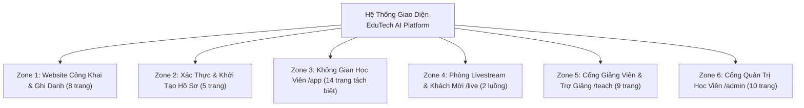

# ĐẶC TẢ CHỨC NĂNG & THIẾT KẾ GIAO DIỆN FRONTEND (SRS FRONTEND)
## Nền Tảng Đào Tạo Trực Tuyến Tích Hợp AI (EduTech AI Platform)

---

## PHẦN I: TỔNG QUAN NGHIỆP VỤ & RÀNG BUỘC KỸ THUẬT

### 1.1. Đối Chiếu Mô Hình Nghiệp Vụ: Hệ Thống Cũ vs Hệ Thống Mới

| Hạng mục | Hệ thống cũ (Marketplace) | Hệ thống mới (Cohort-based Academy) | Ràng buộc Frontend cốt lõi |
| :--- | :--- | :--- | :--- |
| **Mô hình đào tạo** | Chợ khóa học mở cho giảng viên tự do đăng bán video lẻ. | **Học viện Tổ chức (Live Cohort Academy)**. Tổ chức sở hữu khóa học, mở từng Đợt học (`Cohort`) theo lịch trình chuẩn. | Học viên đăng ký theo **Đợt học (`Cohort`)**, học cùng Giảng viên, Trợ giảng (`TA`) và bạn cùng lớp. |
| **Đơn vị học tập** | Video bài giảng ghi sẵn cắt nhỏ. | **Buổi học (`Class Session`)**: Kết hợp linh hoạt giữa Buổi học Livestream trực tuyến và Buổi học dùng Video quay sẵn chất lượng cao. | Cùng 1 cấu trúc Buổi học thống nhất cho cả Live, Bản ghi phát lại (Replay) và Video học liệu quay sẵn. |
| **Quy trình Thanh toán** | Giỏ hàng nhiều khóa, ví giảng viên, chia doanh thu %. | **Thanh toán trực tiếp 1-Click (Direct Checkout)** qua VNPay. Không giỏ hàng, không giới hạn cứng chỗ ngồi gây nghẽn đơn. | Bấm "Đăng ký đợt học" ➔ Trang xác nhận đơn ➔ Cổng VNPay ➔ Kích hoạt vào lớp ngay lập tức. |
| **Xác thực & Khách mời** | Đăng nhập đa kênh rườm rà hoặc tạo tài khoản tạm cho khách mời. | **Email/Mật khẩu + Google OAuth 2.0**. Diễn giả khách mời tham gia qua **Liên kết Khách mời LiveKit (`/live/guest?token=...`)**. | Chỉ có 3 vai trò tài khoản (`STUDENT`, `INSTRUCTOR`, `ADMIN`). Khách mời bấm link là vào thẳng phòng Live, không cần tạo tài khoản. |
| **Hoàn thành Buổi học** | Đếm thời gian treo máy xem video (`watched_seconds`). | **Đánh giá theo Năng lực thực chất**: Học viên vượt qua bài kiểm tra ngắn của buổi học (`SESSION_ASSIGNMENT`) để mở khóa hoàn thành (`is_completed = true`). | Giao diện buổi học gắn kết trực tiếp với thẻ Bài tập kiểm tra hiểu bài ngay bên dưới video. |
| **Khảo thí & Chấm bài** | Trắc nghiệm đơn giản hoặc bắt dựng máy chủ chạy code phức tạp. | **Khảo thí 6 dạng câu hỏi (Trắc nghiệm + Tự luận/Code/Link GitHub/Nộp File) + AI Quiz Generator + AI Co-Grader (`LLM-as-a-Judge`)**. | Không cần IDE chạy code nặng nề; AI hỗ trợ sinh câu hỏi từ bài giảng và chấm nháp tự luận theo barem (Rubric) cho Giảng viên duyệt. |

---

## PHẦN II: PHONG CÁCH THIẾT KẾ, BẢNG MÀU XANH LÁ & NGUYÊN TẮC PHÂN BỔ BỐ CỤC

### 2.1. Triết Lý Thiết Kế: Hiện Đại, Gần Gũi, Thân Thiện & Rạch Ròi
Giao diện được định hướng theo phong cách **Modern Friendly EdTech** (kết hợp sự rõ ràng, mạch lạc của *Linear/Notion* với sự sinh động, truyền cảm hứng học tập của *Duolingo*):
1. **Nguyên tắc "1 Trang – 1 Mục Tiêu Trọng Tâm" (Single-Responsibility Screen):**
   * Tuyệt đối **không nhồi nhét** dữ liệu của nhiều phân hệ vào cùng một màn hình.
   * **Không lạm dụng Tab chồng chéo**: Mỗi màn hình chỉ chứa tối đa **3–4 khối thông tin chính** hoặc **tối đa 3 Tab con**. Những chức năng lớn (như Bảng điểm, Kho tài liệu, Thảo luận, Phân tích sư phạm) phải được tách thành **trang con độc lập trên thanh điều hướng phụ (Sub-navigation)** để giao diện luôn thoáng đãng, tải nhanh và dễ tập trung.
2. **Thân thiện & Truyền cảm hứng (Stickers & Illustrations):**
   * Sử dụng bộ **Sticker / Huy hiệu minh họa Vector 2D đồng bộ tông xanh lá** tại các điểm chạm cảm xúc:
     * *Sticker khích lệ*: Khi học viên hoàn thành buổi học, vượt qua bài kiểm tra, hoặc duy trì chuỗi ngày học liên tiếp (Streak Leaf/Flame).
     * *Nhân vật Trợ giảng AI (AI Companion Avatar)*: Biểu tượng trợ lý AI thân thiện xuất hiện ở khung chat tư vấn và trợ giảng buổi học.
     * *Trạng thái trống (Empty States)*: Minh họa nhẹ nhàng kèm lời dẫn gần gũi khi chưa có bài tập, chưa có thông báo hoặc tìm kiếm không ra kết quả.

---

### 2.2. Hệ Thống Màu Sắc: Tông Xanh Lá Chủ Đạo & Chuyển Sắc Ngữ Nghĩa (Light & Dark Mode)

Hệ thống hỗ trợ chuyển đổi tức thì giữa **Chế độ Sáng (Light Mode)** và **Chế độ Tối (Dark Mode)** với **Tông Xanh Lá Cây (Emerald / Botanical Green)** làm chủ đạo, kết hợp hiệu ứng chuyển màu mượt mà theo ngữ cảnh:

#### A. Bảng Màu Cốt Lõi (Core Theme Tokens)

| Thành phần | Light Mode (Sáng trong, Tươi mới) | Dark Mode (Rừng đêm dịu mắt, Hiện đại) | Mục đích sử dụng |
| :--- | :--- | :--- | :--- |
| **Nền chính (`Background`)** | `#F7FBF9` (Trắng ngà ánh bạc hà cực nhẹ) | `#090F0C` (Đen tuyền ánh xanh rừng sâu) | Nền tổng thể giúp mắt thư giãn khi học lâu. |
| **Bề mặt thẻ (`Surface / Card`)** | `#FFFFFF` (Trắng tinh khiết) | `#111A15` (Xanh đen than chì) | Khối thẻ khóa học, khung bài tập, bảng dữ liệu. |
| **Viền phân cách (`Border`)** | `#DCFCE7` / `#E2E8F0` | `#1E2D24` | Viền mảnh `1px` phân tách rạch ròi các khu vực. |
| **Chữ chính (`Foreground`)** | `#0F172A` (Xanh đen đậm) | `#ECFDF5` (Trắng bạc hà dịu) | Tiêu đề, nội dung bài đọc, câu hỏi thi. |
| **Màu Chủ Đạo (`Primary Green`)** | `#10B981` ➔ Hover `#059669` (Emerald) | `#34D399` ➔ Hover `#10B981` (Mint Emerald) | Nút bấm chính, trạng thái đang chọn, liên kết, tiến độ. |
| **Màu Phụ Trợ (`Secondary Mint`)** | `#D1FAE5` (Nền xanh lá non) | `#064E3B` (Nền xanh lục đậm) | Nhãn kỹ năng, huy hiệu, nền khu vực nổi bật. |

#### B. Hiệu Ứng Chuyển Màu Động & Dải Màu Trạng Thái (Xanh lá ➔ Vàng ➔ Đỏ)
Để giao diện vừa sinh động vừa truyền tải thông tin trực quan ngay lập tức mà không cần đọc nhiều chữ, hệ thống áp dụng **dải chuyển màu theo mức độ (Semantic Color Spectrum)**:

1. **Chuyển sắc Xanh lá (Green Tonal Gradient):**
   * Chuyển từ **Xanh lá non (`#6EE7B7`) ➔ Xanh lục bảo (`#10B981`) ➔ Xanh rừng đậm (`#047857`)**.
   * *Ứng dụng*: Banner Hero trang chủ, vòng tròn tiến độ học tập (`Progress Ring`), thẻ kỹ năng đã làm chủ vững chắc, và hiệu ứng viền sáng khi Trợ lý AI đang phản hồi.
2. **Chuyển sắc Cảnh báo & Thời gian (Xanh lá ➔ Vàng Hổ Phách ➔ Đỏ San Hô):**
   * **Mức 1 — Xanh lá (`#10B981` - An toàn / Tốt / Đạt chuẩn):** Thời gian làm bài còn nhiều (> 30%), điểm năng lực kỹ năng cao (>= 75%), trạng thái giám sát thi ổn định, đoạn video bài giảng học viên hiểu tốt.
   * **Mức 2 — Vàng Cam (`#F59E0B` - Chú ý / Trung bình / Sắp tới hạn):** Thời gian làm bài còn dưới 15 phút, hạn nộp bài tập còn dưới 24 giờ, kỹ năng đang ở mức trung bình (40% – 74%), hoặc cảnh báo trùng lịch học mềm.
   * **Mức 3 — Đỏ San Hô (`#EF4444` - Khẩn cấp / Quá hạn / Đang LIVE):** Thời gian thi còn dưới 3 phút, bài tập quá hạn, điểm nóng học viên tua lại nhiều trên **Biểu đồ Nhiệt Độ Khó Hiểu (Confusion Heatmap)**, cảnh báo vi phạm quy chế thi, hoặc huy hiệu **"ĐANG LIVE"** nhấp nháy.

---

### 2.3. Hoạt Ảnh Tương Tác (Micro-Animations)
Sử dụng `Framer Motion` và `CSS Transitions` có kiểm soát (tự động tắt nếu người dùng bật chế độ *Giảm chuyển động - Reduced Motion*):
* **Hiệu ứng Chuyển trạng thái Màu sắc (Smooth Color Morphing):** Đồng hồ đếm ngược phòng thi và thanh năng lực kỹ năng tự động chuyển màu mượt mà từ **Xanh lá nhạt ➔ Xanh đậm ➔ Vàng ➔ Đỏ** theo thời gian thực.
* **Hiệu ứng Khích lệ Học tập (Celebration Micro-interactions):** Khi học viên nộp bài đạt điểm qua môn (`SESSION_ASSIGNMENT`), nút hoàn thành nở nhẹ kèm sticker huy hiệu xanh lá tỏa sáng.
* **Hiệu ứng Nhịp thở Trực tuyến (Live & AI Pulse):** Chấm tròn phát sáng lan tỏa nhẹ ở nút *"Đang LIVE"* và biểu tượng *Trợ giảng AI* khi đang truyền dữ liệu câu trả lời (Streaming).
* **Hiệu ứng Nổi khối Thẻ (Card Lift):** Khi di chuột qua thẻ khóa học hoặc buổi học, thẻ nhấc nhẹ lên `2px` kèm viền sáng xanh lá tinh tế.

---

### 2.4. Quy Tắc Bố Cục & Phân Bổ Không Gian (Layout Rules)
1. **Lưới chuẩn 12 cột (`Max-width 1360px`):** Khoảng cách giữa các khối tối thiểu `24px`, khoảng đệm trong thẻ (Card Padding) tối thiểu `20px–24px` để mắt luôn có khoảng nghỉ.
2. **Tối đa 1 Hành động Chính (1 Primary CTA) trên mỗi khu vực:** Chỉ nút quan trọng nhất mới mang màu Xanh lá đậm (`Primary Green`), các nút phụ dùng viền mảnh (`Outline`) hoặc nền trong suốt (`Ghost`).
3. **Tách biệt rõ Thanh điều hướng Chính (Left Sidebar) và Điều hướng Ngữ cảnh (Top Sub-nav):** Khi vào trong một Đợt học (`/app/cohorts/:cohortId` hoặc `/teach/cohorts/:cohortId`), các mục con được tách thành từng trang riêng có đường dẫn URL độc lập thay vì nhồi hết vào một trang dài.

---

## PHẦN III: SƠ ĐỒ CẤU TRÚC PHÂN HỆ GIAO DIỆN (6 ZONES RẠCH RÒI)

---

## PHẦN IV: ĐẶC TẢ CHI TIẾT TỪNG TRANG THEO NGUYÊN TẮC "RÕ RÀNG – KHÔNG NHỒI NHÉT"

### ZONE 1: WEBSITE CÔNG KHAI & THANH TOÁN (PUBLIC & MARKETING)

#### 1. Trang Chủ Học Viện (`GET /`)
* **Mục tiêu duy nhất:** Giới thiệu định vị Học viện, hiển thị các đợt học sắp khai giảng và dẫn lối người học tìm đúng chương trình.
* **Bố cục 5 khối rõ ràng (từ trên xuống dưới):**
  1. **Khối Hero (Tông Xanh Lá Chuyển Sắc Nhẹ):** Tiêu đề ngắn gọn, ô tìm kiếm nhanh khóa học, nút mở *Trợ lý AI Tư vấn Lộ trình*, kèm minh họa trực quan về quy trình học tập.
  2. **Khối "Lớp Sắp Khai Giảng":** Hiển thị tối đa 6 thẻ Đợt học (`Cohort`) đang mở đăng ký gần nhất (Tên khóa, Mã đợt, Ngày khai giảng, Lịch học hàng tuần, Số học viên đã đăng ký `enrolled_count`, Học phí niêm yết).
  3. **Khối Danh mục Đào tạo:** Phân nhóm theo lĩnh vực (AI & Dữ liệu, Phần mềm & Cloud, Thiết kế UI/UX, Ngoại ngữ & Kỹ năng) với icon minh họa rõ ràng.
  4. **Khối Quy trình 4 Bước Học tập:** *Học trực tiếp cùng Giảng viên ➔ Ôn tập với Video Replay & AI Tutor ➔ Làm bài tập mở khóa buổi học ➔ Thi cuối khóa nhận Chứng chỉ số*.
  5. **Khối Đội ngũ Giảng viên tiêu biểu & Câu hỏi thường gặp (FAQ).**

#### 2. Trang Danh Mục & Tìm Kiếm Khóa Học (`GET /courses`)
* **Mục tiêu duy nhất:** Giúp người dùng lọc và tìm kiếm khóa học phù hợp.
* **Bố cục 2 cột tách biệt:**
  * **Cột trái (Bộ lọc cố định 280px):** Lọc theo Danh mục, Cấp độ khó (1–5 sao màu từ Xanh lá nhẹ ➔ Vàng ➔ Đỏ), Kỹ năng đạt được, và công tắc *"Chỉ hiện khóa đang mở đợt ghi danh"*.
  * **Cột phải (Lưới kết quả):** Thanh tìm kiếm từ khóa (Debounce 300ms), bộ chọn sắp xếp, và lưới thẻ khóa học (3 cột trên Desktop). Nếu không có kết quả, hiển thị Sticker trạng thái trống kèm nút *"Xóa bộ lọc"*.

#### 3. Trang Chi Tiết Khóa Học & Chọn Đợt Khai Giảng (`GET /courses/:slug`)
* **Mục tiêu duy nhất:** Cung cấp thông tin chương trình học và cho phép chọn 1 Đợt học (`Cohort`) để đăng ký.
* **Bố cục 2 cột (Nội dung chính 8 cột + Thẻ Đăng ký cố định 4 cột):**
  * **Cột chính:**
    1. *Header & Video Giới thiệu*: Tên khóa học, cấp độ, video giới thiệu (YouTube).
    2. *Chuẩn Kỹ năng*: Kỹ năng cần biết trước (`Prerequisites`) và Kỹ năng đạt được sau khóa học (`Learning Outcomes`).
    3. *Khung Chương trình học (`Syllabus Template`)*: Danh sách tuần tự các buổi học dạng Accordion gọn gàng kèm nhãn hoạt động (`Lý thuyết`, `Thực hành`, `Workshop`).
    4. *Danh sách các Đợt khai giảng (`Cohorts`)*: Hiển thị rõ Mã đợt, Ngày bắt đầu – kết thúc, Lịch học trong tuần, Giảng viên & Trợ giảng phụ trách, Ngày mở cổng đăng ký (`enrollment_open_at`), Số học viên đã tham gia (`enrolled_count`), và Học phí.
    5. *Đánh giá từ học viên các khóa trước.*
  * **Cột phải cố định (Sticky Enrollment Card):** Tóm tắt đợt học đang chọn, giá tiền VND, nút **"Đăng ký Đợt học này"** màu xanh lá nổi bật. *(Nếu học viên đã đăng nhập và đợt học đang chọn trùng giờ với một lớp khác mà học viên đang theo học, hiển thị hộp cảnh báo màu vàng cam ngay trên thẻ).*

#### 4. Trang Danh Bạ & Hồ Sơ Giảng Viên (`GET /instructors` & `GET /instructors/:id`)
* **Mục tiêu duy nhất:** Tra cứu thông tin chuyên môn và các lớp giảng dạy của đội ngũ Giảng viên.
* **Hiển thị:** Ảnh đại diện, học hàm/danh hiệu nghề nghiệp, đơn vị công tác, năm kinh nghiệm, tiểu sử chuyên môn, liên kết LinkedIn/GitHub và danh sách các Đợt học giảng viên đó đang đứng lớp.

#### 5. Trang Trợ Lý AI Tư Vấn Chọn Khóa Học (`GET /advisor`)
* **Mục tiêu duy nhất:** Trò chuyện với AI để được tư vấn lộ trình học phù hợp với mục tiêu cá nhân.
* **Giao diện:** Khung chat trung tâm thoáng đãng với nhân vật Sticker AI thân thiện, các nút gợi ý câu hỏi nhanh, phản hồi chữ chạy mượt mà (Streaming SSE) đính kèm **Thẻ Khóa học tương tác trực tiếp** (hiển thị lịch khai giảng và học phí thực tế, bấm vào chuyển thẳng tới trang khóa học).

#### 6. Trang Tra Cứu & Xác Thực Chứng Chỉ Công Khai (`GET /verify/:certificateCode`)
* **Mục tiêu duy nhất:** Kiểm tra tính hợp lệ của chứng chỉ số dành cho nhà tuyển dụng và học viên.
* **Hiển thị:** Huy hiệu trạng thái (**Hợp lệ - Màu Xanh Lá** hoặc **Đã thu hồi - Màu Đỏ** kèm lý do), Bản xem trước chứng chỉ chuẩn in ấn có mã QR, nút Tải PDF và nút Sao chép liên kết xác thực.

#### 7. Trang Xác Nhận Thanh Toán Đợt Học (`GET /checkout/:cohortCode`)
* **Mục tiêu duy nhất:** Kiểm tra thông tin đợt học và chuyển sang cổng thanh toán VNPay (không có giỏ hàng rườm rà).
* **Hiển thị:** Khung xác nhận gọn ở giữa màn hình (`Max-width 640px`): Tên khóa học, Mã đợt học, Lịch khai giảng, Tổng học phí (VND), Cổng thanh toán VNPay và nút **"Tiến hành Thanh toán VNPay"** (có khóa chống bấm đúp `Idempotency Key`).

#### 8. Trang Kết Quả Giao Dịch VNPay (`GET /checkout/result?order=...`)
* **Mục tiêu duy nhất:** Thông báo kết quả thanh toán đơn hàng.
* **Hiển thị 3 trạng thái rõ ràng:**
  * **Thành công (`PAID` - Tông Xanh Lá):** Sticker chúc mừng, mã giao dịch, nút *"Tải lịch học (.ics)"* và nút *"Vào Không Gian Lớp Học"*.
  * **Đang đối soát (`PENDING` - Tông Vàng):** Đồng hồ chờ tự động cập nhật trạng thái từ máy chủ.
  * **Thất bại (`FAILED` / `EXPIRED` - Tông Đỏ):** Nguyên nhân lỗi và nút *"Thử thanh toán lại"*.

---

### ZONE 2: XÁC THỰC, BẢO MẬT & KHỞI TẠO HỒ SƠ (AUTH & ONBOARDING)

#### 9. Trang Đăng Nhập (`GET /login`)
* **Bố cục 2 nửa màn hình:** Bên trái là Form đăng nhập gọn gàng (Email/Mật khẩu + Nút **"Tiếp tục với Google"**); Bên phải là khung minh họa thương hiệu tông xanh lá dịu mắt.

#### 10. Trang Đăng Ký Tài Khoản Học Viên (`GET /register`)
* **Hiển thị:** Họ tên, Email, Mật khẩu (kèm thanh đo độ mạnh mật khẩu chuyển màu **Đỏ ➔ Vàng ➔ Xanh lá** khi đủ độ an toàn) và nút Đăng ký nhanh bằng Google.

#### 11. Trang Quên & Đặt Lại Mật Khẩu (`GET /forgot-password` & `GET /reset-password/:token`)
* **Hiển thị:** Form nhập Email nhận link khôi phục (15 phút) và Form đặt lại mật khẩu mới.

#### 12. Trang Kích Hoạt Email (`GET /verify-email`)
* **Hiển thị:** Trạng thái xác thực mã kích hoạt tự động và nút chuyển vào trang Khởi tạo hồ sơ.

#### 13. Trang Khởi Tạo Hồ Sơ & Khảo Sát Đầu Vào (`GET /onboarding`)
* **Mục tiêu duy nhất:** Thiết lập hồ sơ năng lực ban đầu qua 4 bước ngắn gọn (Stepper từng bước, mỗi bước chỉ hiện 1 nội dung trên màn hình, có nút *"Bỏ qua để làm sau"*):
  * **Bước 1 — Mục tiêu học tập:** Chọn lĩnh vực quan tâm và trình độ hiện tại.
  * **Bước 2 — Trắc nghiệm chẩn đoán nhanh (5 câu):** Xác định mức nền tảng ban đầu (giao diện thân thiện, không tạo áp lực điểm số).
  * **Bước 3 — Chụp Ảnh Khuôn Mặt Tham Chiếu (Face Reference):** Chụp 1 ảnh chân dung qua Webcam để làm gốc đối chiếu cho các kỳ thi cuối khóa có giám sát AI.
  * **Bước 4 — Gợi ý Lộ trình:** Hiển thị 3 khóa học phù hợp nhất với kết quả khảo sát.

---

### ZONE 3: KHÔNG GIAN HỌC TẬP CỦA HỌC VIÊN (`/app`)
*(Tuân thủ nghiêm ngặt nguyên tắc tách trang: Không nhồi nhét biểu đồ phân tích sâu vào Dashboard, và không nhồi 6 Tab vào 1 trang lớp học).*

#### 14. Bảng Điều Khiển Học Tập Hàng Ngày (`GET /app`)
* **Mục tiêu duy nhất:** Giúp học viên biết **hôm nay cần học buổi nào và làm bài tập nào** ngay khi vừa đăng nhập.
* **Chỉ hiển thị đúng 3 khối hành động thiết yếu:**
  1. **Banner "Lớp Học Hôm Nay":** Nếu có buổi học đang phát trực tiếp, hiển thị thẻ viền **Đỏ/Xanh chuyển sắc** kèm nhãn **"ĐANG LIVE"** và nút *"Vào phòng học ngay"*. Nếu sắp diễn ra trong 60 phút, hiển thị đồng hồ đếm ngược.
  2. **Khối "Tiếp Tục Học Tập & Chuỗi Ngày Học (Streak)":** Thẻ buổi học đang xem dở (bấm để phát tiếp đúng giây dừng lại) kết hợp huy hiệu Sticker **Chuỗi ngày học liên tiếp (Streak Leaf)**.
  3. **Khối "Bài Tập Cần Hoàn Thành":** Danh sách tối đa 4 bài tập/bài kiểm tra sắp đến hạn (hiển thị nhãn màu Xanh lá ➔ Vàng ➔ Đỏ tùy theo số giờ còn lại).

#### 15. Danh Sách Đợt Học Đã Ghi Danh (`GET /app/learning`)
* **Mục tiêu duy nhất:** Quản lý toàn bộ các Đợt học (`Cohort`) mà học viên đang học hoặc đã tốt nghiệp.
* **Hiển thị:** Bộ lọc *"Đang học"* / *"Đã hoàn thành"*, lưới thẻ Đợt học với vòng tròn tiến độ màu xanh lá (`% buổi học đã hoàn thành`), lịch buổi kế tiếp, tên Giảng viên & Trợ giảng, và nút vào lớp.

#### 16. Không Gian Lớp Học — Lộ Trình Buổi Học (`GET /app/cohorts/:cohortId`)
* **Mục tiêu duy nhất:** Hiển thị lộ trình các buổi học của đợt học theo từng tuần (thay vì nhồi 6 tab nặng nề, Không gian lớp học sử dụng **Thanh điều hướng phụ gọn gàng** chia thành 3 trang con rõ ràng: `Lộ trình Buổi học`, `Bài tập & Điểm số`, `Thảo luận & Tài liệu`).
* **Hiển thị tại trang Lộ trình Buổi học:**
  * **Header Lớp học:** Tên khóa, mã đợt, Giảng viên chính (`INSTRUCTOR`) và Trợ giảng (`TA`), nút *"Tải lịch học (.ics)"*, và thanh tiến độ tổng.
  * **Danh sách Buổi học theo Tuần (Vertical Timeline):** Mỗi thẻ buổi học hiển thị rõ:
    * Thứ tự buổi, Tiêu đề, Nhãn hoạt động (`Lý thuyết`, `Thực hành`, `Workshop`), Người đứng lớp.
    * Trạng thái trực quan: `Sắp diễn ra` (kèm ngày giờ), `ĐANG LIVE` (nút vào phòng trực tuyến), `Đang xử lý bản ghi`, hoặc `Đã có Video & Học liệu`.
    * **Huy hiệu Hoàn thành (Dấu tích Xanh lá + Sticker nhỏ):** Được bật sáng khi học viên đã vượt qua bài kiểm tra ngắn (`SESSION_ASSIGNMENT`) của buổi học đó.

#### 17. Không Gian Lớp Học — Bài Tập & Bảng Điểm (`GET /app/cohorts/:cohortId/assessments`)
* **Mục tiêu duy nhất:** Theo dõi danh sách bài tập định kỳ theo buổi, kỳ thi cuối khóa và bảng điểm cá nhân trong đợt học.
* **Hiển thị:**
  * Thẻ tổng kết điểm trung bình hiện tại và điều kiện đủ để dự thi cuối khóa / nhận chứng chỉ.
  * Danh sách toàn bộ Bài kiểm tra buổi học (`SESSION_ASSIGNMENT`) và Bài thi cuối khóa (`FINAL_EXAM`) kèm trạng thái màu sắc: *Chưa làm (Xám), Đang chấm (Vàng), Đạt yêu cầu (Xanh lá), Chưa đạt / Quá hạn (Đỏ)*.

#### 18. Không Gian Lớp Học — Thảo Luận & Kho Học Liệu (`GET /app/cohorts/:cohortId/discussions`)
* **Mục tiêu duy nhất:** Trao đổi học thuật với Giảng viên/Trợ giảng/Bạn cùng lớp và tra cứu nhanh toàn bộ tài liệu đính kèm của đợt học.
* **Bố cục 2 khu vực rõ ràng:**
  * Danh sách chủ đề thảo luận của lớp (lọc theo *Chưa giải quyết*, *Đã được Giảng viên/TA xác nhận*, *Câu hỏi của tôi*).
  * Ngăn kéo hoặc bộ lọc nhanh *Kho Tài liệu chung của lớp* (tìm nhanh file PDF, slide, tài liệu bài tập của mọi buổi học).

#### 19. Phòng Học Video & Trợ Giảng AI Đa Phương Thức (`GET /app/cohorts/:cohortId/sessions/:sessionId`)
* **Mục tiêu duy nhất:** Xem bài giảng (Replay hoặc Video quay sẵn), tra cứu tài liệu buổi học, hỏi Trợ giảng AI và mở làm bài kiểm tra hoàn thành buổi học.
* **Bố cục 2 cột khoa học (Không nhồi 5–6 tab gây chật hẹp):**
  * **Cột Trái (70% chiều rộng) — Trình Phát Video & Nội Dung Trọng Tâm Buổi Học:**
    1. **Trình phát HLS Bảo mật (`SecureHlsPlayer`):** Hỗ trợ chọn chất lượng, tốc độ phát, phụ đề tiếng Việt, phím tắt, mốc chương bài học (Chapters), và lớp phủ **Dynamic Watermark** bảo vệ bản quyền.
    2. **Thẻ Bài Tập Mở Khóa Buổi Học (Nằm ngay dưới Video):** Hiển thị trạng thái bài kiểm tra ngắn của buổi học (`SESSION_ASSIGNMENT`) với nút **"Làm bài kiểm tra để hoàn thành buổi học"** nổi bật.
    3. **Tóm tắt Bài giảng bởi AI (`AI Summary`) & Tài liệu Đính kèm (`Attachments`):** Trình bày thoáng đãng bên dưới video, hỗ trợ bấm xem trực tiếp file Slide PDF hoặc tải tài liệu về máy.
  * **Cột Phải (30% chiều rộng) — Khung Tương Tác Thời Gian Thực (Chỉ gồm 3 Tab gọn gàng):**
    1. **Tab 1 — Lời giảng đồng bộ (`Transcript`):** Chữ chạy tự động theo từng giây video; bấm vào câu bất kỳ để tua video đến đúng giây đó; có ô tìm từ khóa.
    2. **Tab 2 — Trợ giảng AI (`AI Session Tutor`):** Hỏi đáp trực tiếp về nội dung buổi học; câu trả lời của AI đính kèm **Nút trích dẫn mốc thời gian (`mm:ss`) và số trang PDF** bấm vào là nhảy thẳng tới đoạn video/trang tài liệu tương ứng.
    3. **Tab 3 — Hỏi đáp theo mốc video (`Q&A`):** Xem và đặt câu hỏi gắn với giây video đang phát; hiển thị rõ câu trả lời nháp của AI và câu trả lời đã được Giảng viên/TA xác nhận.

#### 20. Phòng Làm Bài Kiểm Tra & Nộp Bài Tập (`GET /app/assessments/:assessmentId`)
* **Mục tiêu duy nhất:** Xem quy chế bài kiểm tra và thực hiện làm bài trực tuyến với giao diện tập trung tối đa.
* **Bố cục:**
  * **Màn hình chờ bắt đầu:** Hiển thị thời gian làm bài, điểm đạt yêu cầu, số lần làm bài cho phép và lịch sử các lần nộp trước.
  * **Màn hình làm bài tập trung:**
    * *Thanh Header cố định*: Đồng hồ đếm ngược tự động chuyển màu **Xanh lá ➔ Vàng (còn 5 phút) ➔ Đỏ (còn 1 phút)**, trạng thái tự động lưu bài, nút Nộp bài.
    * *Khung câu hỏi chính (Hỗ trợ 6 dạng câu hỏi chuẩn)*:
      1. `SINGLE_CHOICE`: Trắc nghiệm 1 đáp án.
      2. `MULTI_SELECT`: Trắc nghiệm nhiều đáp án.
      3. `TRUE_FALSE`: Đúng / Sai.
      4. `SHORT_ANSWER`: Điền câu trả lời ngắn.
      5. `ESSAY`: Soạn thảo tự luận Markdown (viết phân tích, dán đoạn code có tô màu cú pháp, hoặc đính kèm link GitHub Repository).
      6. `FILE_SUBMISSION`: Kéo thả tệp bài làm (`.zip`, `.pdf`, hoặc thu âm giọng nói trực tiếp).
    * *Bảng danh sách số thứ tự câu hỏi bên phải*: Phân màu rõ câu đã làm (Xanh lá), câu đánh dấu xem lại (Vàng), câu chưa làm (Xám).

#### 21. Trang Kết Quả Bài Thi, Nhận Xét AI Co-Grader & Lộ Trình Ôn Tập (`GET /app/assessments/:assessmentId/results/:attemptId`)
* **Mục tiêu duy nhất:** Xem điểm số, lời phê chi tiết từng câu (bao gồm bảng chấm điểm Rubric từ `AI Co-Grader` đã được Giảng viên duyệt) và gợi ý ôn tập.
* **Hiển thị 3 phần rõ ràng:**
  1. **Thẻ Tổng kết Điểm số & Trạng thái Hoàn thành:** Hiển thị điểm đạt được, Sticker chúc mừng nếu vượt qua bài tập buổi học (tự động tích xanh hoàn thành buổi học đó).
  2. **Kế hoạch Ôn tập Cá nhân hóa (`AI Remedial Plan`):** Với những kỹ năng làm sai, AI chỉ rõ **cần xem lại Buổi học nào, từ phút `mm:ss` đến `mm:ss` nào**, bấm vào là mở ngay đoạn video đó để ôn lại.
  3. **Chi tiết từng câu trả lời & Bảng điểm Rubric:** Hiển thị đáp án của học viên, điểm từng tiêu chí và nhận xét chi tiết.

#### 22. Phòng Thi Cuối Khóa Có Giám Sát AI (`GET /app/exams/:assessmentId`)
* **Mục tiêu duy nhất:** Đảm bảo kỳ thi tốt nghiệp diễn ra nghiêm túc, công bằng với sự hỗ trợ của AI Thị giác máy tính.
* **Quy trình 2 giai đoạn:**
  1. **Bước Kiểm tra Trước giờ thi (Pre-check Stepper):** Kiểm tra Camera/Mạng ➔ Chụp ảnh đối khớp khuôn mặt với ảnh gốc (`Face Verification`) ➔ Xác nhận quy chế thi toàn màn hình.
  2. **Không gian Làm bài Toàn màn hình:** Tích hợp khung camera thu nhỏ ở góc màn hình kèm huy hiệu trạng thái giám sát chuyển màu **Xanh lá (Ổn định) ➔ Vàng (Nhắc nhở nhẹ khi quay mặt/rời khung hình) ➔ Đỏ (Cảnh báo thoát toàn màn hình hoặc phát hiện nhiều người)**. Ngôn từ nhắc nhở lịch sự, tôn trọng học viên.

#### 23. Trang Hồ Sơ Năng Lực & Bản Đồ Kỹ Năng (`GET /app/progress`)
* **Mục tiêu duy nhất:** Trực quan hóa sự tiến bộ về kỹ năng và gợi ý lộ trình học tiếp theo (gom gọn biểu đồ năng lực và bản đồ kỹ năng vào một trung tâm phân tích cá nhân duy nhất, không tách vụn cũng không làm rối Dashboard).
* **Hiển thị:**
  1. **Biểu đồ Radar Năng lực & Nhiệt đồ học tập (Activity Heatmap tông xanh lá):** Thể hiện mức độ làm chủ các kỹ năng từ thấp đến cao (chuyển sắc **Đỏ ➔ Vàng ➔ Xanh lá đậm**).
  2. **Sơ đồ Cây Kỹ năng Tiên quyết (Skill Tree DAG):** Các nút kỹ năng đã nắm vững sáng màu Xanh lá, kỹ năng đang học màu Vàng, kỹ năng mở tiếp theo kèm đề xuất khóa học theo vùng phát triển gần nhất (`ZPD`).

#### 24. Lịch Sử Hội Thoại Với Trợ Lý AI (`GET /app/chats`)
* **Mục tiêu duy nhất:** Xem lại và tiếp tục các cuộc trò chuyện trước đây với Trợ lý tư vấn khóa học hoặc Trợ giảng AI của từng buổi học.

#### 25. Bộ Sưu Tập Chứng Chỉ & Lịch Sử Đơn Hàng (`GET /app/certificates` & `GET /app/billing`)
* **Mục tiêu duy nhất:** Xem, tải xuống bản PDF chứng chỉ số đã đạt được và tra cứu biên lai thanh toán VNPay.

#### 26. Cài Đặt Tài Khoản, Giao Diện & Dữ Liệu Khuôn Mặt (`GET /app/settings`)
* **Mục tiêu duy nhất:** Quản lý thông tin cá nhân, bảo mật mật khẩu/Google, chụp lại ảnh khuôn mặt tham chiếu thi cử, và chuyển đổi chế độ **Light Mode / Dark Mode**.

---

### ZONE 4: PHÒNG HỌC TRỰC TUYẾN & KHÁCH MỜI (LIVESTREAM STUDIO - `/live`)

#### 27. Phòng Livestream Lớp Học WebRTC LiveKit (`GET /live/:sessionId`)
* **Mục tiêu duy nhất:** Không gian học trực tuyến thời gian thực mượt mà cho Giảng viên, Trợ giảng và Học viên.
* **Giao diện Toàn màn hình (Dark Mode chuyên dụng chống mỏi mắt):**
  * **Sảnh chờ kiểm tra thiết bị (Pre-join Lobby):** Kiểm tra Mic, Camera, chọn thiết bị âm thanh trước khi bấm *"Vào lớp học"*.
  * **Sân khấu chính (Center Stage):** Hiển thị màn hình chia sẻ bài giảng của Giảng viên và lưới camera người tham gia.
  * **Thanh điều khiển phía dưới:** Bật/tắt Mic, Camera, Chia sẻ màn hình (Giảng viên/TA), Giơ tay phát biểu, Thả biểu tượng cảm xúc tương tác (Reactions bay lên nhẹ nhàng), Rời phòng.
  * **Khung Tương tác bên phải (3 Tab gọn gàng):**
    1. *Trò chuyện lớp học (`Chat`)*
    2. *Hỏi đáp có bình chọn (`Q&A Upvote`)*
    3. *Trợ lý AI Trực tiếp (`AI Live Copilot`)*: Hiển thị phụ đề lời giảng trực tiếp; có nút **"Tóm tắt 10 phút vừa qua"** cho học viên vào muộn và bảng **"Gom nhóm câu hỏi trùng lặp"** cho Giảng viên/TA.

#### 28. Cổng Tham Gia Nhanh Dành Cho Diễn Giả Khách Mời (`GET /live/guest?token=...`)
* **Mục tiêu duy nhất:** Cho phép chuyên gia khách mời bên ngoài tham gia chia sẻ trong buổi học chỉ bằng 1 đường link mời mà **không cần đăng ký tài khoản hệ thống**.
* **Giao diện:** Kiểm tra tính hợp lệ của mã Token khách mời ➔ Hiển thị tên buổi học và tên Khách mời ➔ Kiểm tra Camera/Mic ➔ Vào thẳng phòng LiveKit với quyền bật Camera, Mic và Chia sẻ màn hình cho riêng buổi học đó.

---

### ZONE 5: CỔNG GIẢNG VIÊN & TRỢ GIẢNG (`/teach`)
*(Áp dụng phân tách trang con rõ ràng để Giảng viên và Trợ giảng thao tác nhanh, không bị ngợp bởi một màn hình chứa quá nhiều bảng biểu).*

#### 29. Bảng Điều Khiển Giảng Dạy (`GET /teach`)
* **Mục tiêu duy nhất:** Tổng hợp lịch dạy hôm nay và các đầu việc cần xử lý ngay của Giảng viên / Trợ giảng.
* **Hiển thị 3 khối rõ ràng:**
  1. **Buổi học sắp diễn ra hôm nay:** Nút *"Mở phòng Livestream"* và nút *"Tạo link mời Diễn giả khách mời (1-Click Guest Link)"*.
  2. **Hàng đợi Bài tập chờ duyệt chấm (`AI Co-Grader Queue`):** Số lượng bài tự luận đã được AI chấm nháp đang chờ Giảng viên/TA xác nhận.
  3. **Danh sách Học viên cần hỗ trợ (`At-Risk Students`):** Cảnh báo những học viên chưa hoàn thành bài tập nhiều buổi liên tiếp.

#### 30. Lịch Giảng Dạy & Đăng Ký Khung Giờ Rảnh (`GET /teach/schedule`)
* **Mục tiêu duy nhất:** Xem lịch đứng lớp theo Tuần/Tháng và đánh dấu các khung giờ rảnh trong tuần để hệ thống xếp lịch.

#### 31. Quản Lý Lớp Học — Buổi Học & Học Liệu (`GET /teach/cohorts/:cohortId`)
* **Mục tiêu duy nhất:** Quản lý danh sách các buổi học, tải lên tài liệu/video bài giảng và duyệt bản ghi sau buổi Livestream.
* **Hiển thị:**
  * Danh sách các buổi học của đợt học.
  * Ngăn kéo cập nhật buổi học: Chỉnh sửa tiêu đề, mô tả, tải lên Slide PDF/tài liệu, tải lên Video quay sẵn, hoặc bấm **"Duyệt xuất bản Bản ghi Livestream & Nạp tri thức AI"**.
  * Nút **"Dời lịch buổi học (Reschedule)"**: Cho phép chọn ngày giờ mới kèm kiểm tra tự động chống trùng lịch dạy của giảng viên và cảnh báo số học viên bị trùng giờ học.

#### 32. Quản Lý Lớp Học — Học Viên & Sổ Điểm (`GET /teach/cohorts/:cohortId/students`)
* **Mục tiêu duy nhất:** Theo dõi tiến độ hoàn thành buổi học và bảng điểm tổng hợp của từng học viên trong lớp (hỗ trợ xuất file Excel/CSV).

#### 33. Quản Lý Lớp Học — Phân Tích Sư Phạm & Thảo Luận (`GET /teach/cohorts/:cohortId/analytics`)
* **Mục tiêu duy nhất:** Giúp Giảng viên nắm bắt đoạn bài giảng nào học viên khó hiểu nhất và duyệt trả lời các câu hỏi thảo luận.
* **Hiển thị:**
  * **Biểu đồ Nhiệt Độ Khó Hiểu (`Confusion Heatmap`):** Thanh thời gian video chuyển màu từ **Xanh lá (Học viên xem mượt) ➔ Vàng ➔ Đỏ (Điểm nóng học viên tua lại/tạm dừng/hỏi nhiều nhất)**. Bấm vào vùng màu Đỏ để xem ngay đoạn lời giảng và câu hỏi tại mốc đó.
  * Danh sách câu hỏi thảo luận trong lớp kèm nút *"Xác nhận câu trả lời nháp của AI"*.

#### 34. Trình Tạo Đề Kiểm Tra & Sinh Câu Hỏi Bằng AI (`GET /teach/assessments/:id/edit`)
* **Mục tiêu duy nhất:** Biên soạn đề kiểm tra buổi học (`SESSION_ASSIGNMENT`) hoặc đề thi cuối khóa (`FINAL_EXAM`).
* **Chức năng nổi bật:**
  * Hỗ trợ tạo câu hỏi theo 6 định dạng chuẩn (`SINGLE_CHOICE`, `MULTI_SELECT`, `TRUE_FALSE`, `SHORT_ANSWER`, `ESSAY`, `FILE_SUBMISSION`) và thiết lập barem điểm (`Rubric`) cho câu tự luận.
  * **Công cụ `AI Quiz Generator`:** Chọn buổi học ➔ Chọn số lượng câu hỏi muốn tạo ➔ AI tự động đọc lời giảng và tài liệu của buổi đó để sinh bộ câu hỏi kèm đáp án và giải thích chi tiết chỉ trong vài giây ➔ Giảng viên kiểm tra và bấm lưu.

#### 35. Bàn Chấm Bài Tập Cùng Trợ Lý AI Co-Grader (`GET /teach/grading`)
* **Mục tiêu duy nhất:** Chấm điểm nhanh các bài làm Tự luận / Code / Dự án / File đính kèm của học viên với sự trợ giúp của `AI Co-Grader`.
* **Bố cục 2 cột đối xứng rõ ràng:**
  * **Cột Trái:** Bài làm của học viên (Văn bản Markdown, đoạn code có tô màu cú pháp, link GitHub Repo hoặc trình xem file PDF/Audio).
  * **Cột Phải:** Bảng tiêu chí chấm điểm (`Rubric`) kèm **Khung Gợi ý Chấm điểm từ AI Co-Grader** (hiển thị điểm đề xuất cho từng tiêu chí và lời nhận xét chi tiết ưu/nhược điểm do AI soạn sẵn). Giảng viên chỉ cần bấm **"Áp dụng gợi ý AI"**, chỉnh sửa thêm nếu muốn rồi bấm **"Xác nhận & Lưu điểm"** (`Ctrl + Enter`).

#### 36. Bàn Duyệt Bằng Chứng Giám Sát Thi (`GET /teach/proctoring/:attemptId`)
* **Mục tiêu duy nhất:** Xem xét các ca thi cuối khóa có cảnh báo bất thường từ hệ thống giám sát AI.
* **Hiển thị:** Dòng thời gian các sự kiện cảnh báo kèm ảnh chụp khoảnh khắc vi phạm (Lightbox), điểm rủi ro tổng hợp và 3 nút phán quyết rõ ràng: `Hợp lệ (Clean)`, `Miễn trừ có lý do (Cleared)`, hoặc `Xác nhận vi phạm (Confirmed Cheat)`.

#### 37. Hồ Sơ Công Khai Giảng Viên (`GET /teach/profile`)
* **Mục tiêu duy nhất:** Cập nhật thông tin giới thiệu, kinh nghiệm và liên kết mạng xã hội hiển thị trên trang chủ.

---

### ZONE 6: CỔNG QUẢN TRỊ HỌC VIỆN (ADMIN PORTAL - `/admin`)

#### 38. Trung Tâm Điều Hành Học Viện (`GET /admin`)
* **Mục tiêu duy nhất:** Nắm bắt các chỉ số vận hành cốt lõi toàn hệ thống trên 1 màn hình tổng quan thoáng đãng.
* **Hiển thị:** 4 thẻ KPI chính (Tổng học viên đang học, Doanh thu tháng VND, Số đợt học đang mở, Chi phí AI tháng), Biểu đồ doanh thu & ghi danh theo tháng (tông màu Xanh lá chủ đạo), và Danh sách các buổi học đang phát Livestream.

#### 39. Quản Lý Khóa Học & Khung Giáo Trình Mẫu (`GET /admin/courses`)
* **Mục tiêu duy nhất:** Tạo và cập nhật các Khóa học gốc (`Courses`), gán chuẩn Kỹ năng đầu vào/đầu ra và thiết kế Khung chương trình mẫu (`Syllabus Template`).

#### 40. Quản Lý Từ Điển Kỹ Năng & Danh Mục (`GET /admin/skills`)
* **Mục tiêu duy nhất:** Quản trị cây danh mục đào tạo và bộ từ điển kỹ năng chuẩn của Học viện.

#### 41. Quản Trị Đợt Học, Phân Công Giảng Viên/TA & Lịch Học (`GET /admin/cohorts`)
* **Mục tiêu duy nhất:** Mở các Đợt học (`Cohorts`) mới từ Khóa học gốc, thiết lập học phí, ngày mở đăng ký (`enrollment_open_at`), gán Giảng viên chính (`INSTRUCTOR`) + Trợ giảng (`TA`), và quản lý lịch các buổi học trong đợt.

#### 42. Công Cụ Xếp Lịch Tự Động Bằng AI (`GET /admin/scheduler`)
* **Mục tiêu duy nhất:** Tự động xếp lịch học cho nhiều đợt học cùng lúc dựa trên thời gian rảnh của giảng viên và ràng buộc ngôn ngữ tự nhiên (không trùng giờ giảng viên).

#### 43. Quản Lý Tài Khoản Người Dùng & Đội Ngũ Giảng Dạy (`GET /admin/users`)
* **Mục tiêu duy nhất:** Quản lý danh sách Học viên, Giảng viên và Quản trị viên; cấp tài khoản mới cho Giảng viên/TA; khóa hoặc mở khóa tài khoản.

#### 44. Quản Lý Đơn Hàng & Đối Soát VNPay (`GET /admin/orders`)
* **Mục tiêu duy nhất:** Tra cứu lịch sử đơn hàng ghi danh và nhật ký giao dịch IPN trả về từ cổng thanh toán VNPay.

#### 45. Cấp Phát & Thu Hồi Chứng Chỉ Số (`GET /admin/certificates`)
* **Mục tiêu duy nhất:** Duyệt cấp chứng chỉ hàng loạt 1-Click cho học viên đã hoàn thành đợt học và đỗ kỳ thi cuối khóa; hoặc thu hồi chứng chỉ khi phát hiện vi phạm.

#### 46. Quản Trị Kho Tri Thức RAG & Kiểm Thử Tìm Kiếm (`GET /admin/knowledge`)
* **Mục tiêu duy nhất:** Quản lý các nguồn tài liệu đã nạp vào Vector Database (`pgvector`), chạy lại chỉ mục (Re-index) và thử nghiệm chất lượng truy xuất câu trả lời (`Retrieval Playground`).

#### 47. Giám Sát Chi Phí AI & Cấu Hình Hệ Thống (`GET /admin/settings`)
* **Mục tiêu duy nhất:** Theo dõi lượng Token tiêu thụ, độ trễ phản hồi của các tính năng AI (Gemini / Fallback) và chỉnh sửa các tham số cấu hình toàn hệ thống (`system_settings`).

---

## PHẦN V: CÁC THÀNH PHẦN DÙNG CHUNG TOÀN HỆ THỐNG (GLOBAL WIDGETS)

1. **Thanh Tìm Kiếm Nhanh (`Command Palette — Ctrl + K`):** Bấm phím tắt ở bất kỳ trang nào để nhảy nhanh tới một khóa học, buổi học hoặc trang chức năng.
2. **Nút Chuyển Đổi Giao Diện Sáng / Tối (`Theme Toggle — Light / Dark Green Mode`):** Đặt ngay trên thanh Header giúp người học đổi giao diện Sáng/Tối tức thì với hiệu ứng chuyển nền mượt mà.
3. **Chuông Thông Báo Thời Gian Thực (`Notification Popover`):** Nhận thông báo tức thì khi lớp sắp bắt đầu Live, khi giảng viên dời lịch học, hoặc khi bài tập đã được chấm điểm.
4. **Lớp Phủ Bảo Vệ Bản Quyền Video (`Dynamic Watermark Canvas`):** Hiển thị mờ Email + Mã định danh người học di chuyển ngẫu nhiên trên khung hình video.

---

## PHẦN VI: QUY TẮC BẢO MẬT & TIÊU CHUẨN CHẤT LƯỢNG GIAO DIỆN

1. **Bảo mật Đề thi & Đáp án:** Dữ liệu API trả về cho Học viên (`AssessmentItemStudent`) tuyệt đối không chứa trường đáp án đúng (`grading`) hay barem chấm điểm ẩn.
2. **Bảo vệ Phiên đăng nhập:** Access Token chỉ lưu trong bộ nhớ RAM của ứng dụng; Refresh Token lưu trong `HttpOnly Cookie` kết hợp cơ chế tự động gia hạn ngầm (`Silent Refresh`).
3. **Trải nghiệm Mượt mà trên mọi Thiết bị (Responsive):** Tương thích hoàn hảo từ màn hình Laptop/PC lớn đến Máy tính bảng và Điện thoại di động; mọi trang đều có khung xương tải dữ liệu (`Skeleton Loading`) đồng bộ tông xanh lá, không bao giờ để màn hình trắng trống trải khi chờ mạng.
