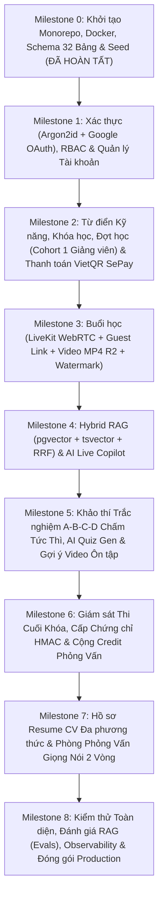

# 05. Lộ Trình Triển Khai Chi Tiết Từng Giai Đoạn (Implementation Roadmap)

> **Tài liệu này chia quá trình xây dựng hệ thống thành 9 Milestone tuần tự, bám sát kiến trúc 32 bảng chuẩn hóa và 14 quyết định nghiệp vụ cốt lõi.** Mỗi Milestone có phạm vi rõ ràng, danh sách tệp cần hoàn thiện và tiêu chí nghiệm thu cụ thể.

---

## Tổng Quan 9 Milestones

---

## Chi Tiết Từng Milestone & Tiêu Chí Nghiệm Thu

### Milestone 0: Khởi Tạo Hạ Tầng, Monorepo & Lược Đồ CSDL 32 Bảng *(Đã hoàn tất)*
- **Hạng mục thực hiện:**
  - Cấu trúc Monorepo (`apps/api`, `apps/ai-service`, `apps/web`, `infra`, `docs`).
  - `docker-compose.dev.yml` chạy PostgreSQL 16 (`pgvector/pgvector:pg16`) và Redis 7 (`redis:7-alpine`).
  - Định nghĩa đầy đủ 32 bảng đồng bộ 100% giữa `apps/api/src/db/migrations/0000_baseline.sql` và `apps/api/src/db/schema/`.
  - Hợp đồng dữ liệu TypeScript tại `apps/web/src/shared/types/contracts.ts`.
- **Cách kiểm tra nghiệm thu:**
  - Chạy `npm run dev:infra` lên container Postgres và Redis trạng thái `healthy`.
  - Chạy `npm --prefix apps/api run db:migrate` tạo thành công 32 bảng và các chỉ mục HNSW/GIN/GiST (`EXCLUDE USING gist`).
  - Chạy `npm --prefix apps/api run db:seed` tạo tài khoản Admin mặc định (`admin@edutech.vn` / `Admin@2026!`) và 11 kỹ năng chuẩn của Học viện.

---

### Milestone 1: Xác Thực Tinh Gọn, Phân Quyền 3 Vai Trò & Onboarding
- **Phía Backend (`apps/api/src/modules/auth/`, `users/`):**
  - Đăng ký học viên (`Argon2id`), xác thực email, quên/đặt lại mật khẩu.
  - Đăng nhập Email/Password + Đăng nhập nhanh Google OAuth 2.0 (tự động gộp tài khoản trùng email đã xác thực).
  - Cơ chế xoay vòng Refresh Token trong Redis + `HttpOnly Cookie`.
  - Middleware `requireAuth`, `requireRole(['STUDENT' | 'INSTRUCTOR' | 'ADMIN'])` và `requireCohortInstructor`.
  - API Admin tạo tài khoản Giảng viên (`INSTRUCTOR`).
  - API lưu mục tiêu nghề nghiệp và ảnh khuôn mặt tham chiếu (`face_reference_r2_key` + `face_embedding`).
- **Phía Frontend (`apps/web/src/features/auth/`, `onboarding/`):**
  - Các trang `/login`, `/register`, `/onboarding`.

---

### Milestone 2: Danh Mục Kỹ Năng, Khóa Học, Đợt Học (`Cohort`) & Thanh Toán VietQR SePay
- **Phía Backend (`apps/api/src/modules/courses/`, `cohorts/`, `orders/`):**
  - CRUD Danh mục (`categories`), Từ điển Kỹ năng (`skills`), Khóa học (`courses`, `course_skills`, `syllabus_template`).
  - Mở Đợt học (`cohorts`) gán 1 Giảng viên phụ trách (`instructor_id`), tự động sinh danh sách `class_sessions` từ `syllabus_template` và kiểm tra chống trùng lịch dạy bằng `EXCLUDE USING gist`.
  - Luồng thanh toán chuyển khoản ngân hàng tự động qua **VietQR & SePay Webhook**:
    - Tạo đơn (`orders`) kèm mã đơn `order_code` (`ET2026...`) và khóa lũy đẳng `idempotency_key`.
    - Nhận Webhook SePay (`POST /api/v1/webhooks/sepay`), lưu đối soát `payment_transactions` (`match_status`), khóa hàng nguyên tử `SELECT ... FOR UPDATE`, mở khóa `enrollments` và cộng `enrolled_count` trong 3 giây.
- **Phía Frontend (`apps/web/src/features/catalog/`, `checkout/`, `admin/`):**
  - Trang chủ `/`, Về Học viện `/about`, Danh mục `/courses`, Chi tiết khóa học `/courses/:slug`.
  - Trang thanh toán VietQR `/checkout/:cohortCode`.
  - Giao diện Admin quản lý khóa học, kỹ năng và mở đợt học.

---

### Milestone 3: Không Gian Lớp Học, Phòng LiveKit WebRTC (+ Guest Link) & Trình Phát Video MP4
- **Phía Backend & Worker (`apps/api/src/modules/sessions/`, `apps/ai-service/src/worker/`):**
  - Cấp LiveKit Token phân quyền (`instructor_id` / `ADMIN` làm Host; `STUDENT` làm người học) và **sinh Link Mời Diễn Giả 1 chạm (`createGuestSpeakerToken`)** cho khách mời bên ngoài vào phòng Live không cần tài khoản DB.
  - Lưu trữ bản ghi buổi học `.mp4` trên Cloudflare R2 (`video_r2_key`), trích xuất phụ đề `.vtt` chuẩn thuật ngữ chuyên ngành và băm đoạn vào `knowledge_chunks`.
  - Lưu vị trí xem video (`last_position_sec`).
- **Phía Frontend (`apps/web/src/features/cohort-workspace/`, `session/`, `live-room/`):**
  - Dashboard học viên `/app`, Không gian đợt học `/app/cohorts/:cohortId`.
  - Phòng học Video `/app/cohorts/:cohortId/sessions/:sessionId` với trình phát HTML5 tích hợp **Dynamic Watermark** và 3 tab bên phải (`Lời giảng`, `Hỏi Trợ giảng AI`, `Hỏi đáp lớp học`).
  - Phòng học trực tuyến `/live/:sessionId` và `/live/guest`.

---

### Milestone 4: Kho Tri Thức Hybrid RAG (Có Citations Bấm Được) & AI Live Copilot
- **Phía AI Service (`apps/ai-service/src/rag/`, `live_copilot/`):**
  - Bóc tách Slide PDF và phụ đề `.vtt` thành các `knowledge_chunks` kèm `start_sec`, `end_sec`, `page_number` và `embedding vector(1024)`.
  - Truy vấn **Hybrid Search (`pgvector` HNSW + `tsvector` GIN + RRF)**.
  - Trợ lý Tư vấn Tuyển sinh (`/advisor` - `visibility = 'PUBLIC'`) và Trợ giảng Buổi học (`SESSION_TUTOR` - cô lập theo `cohort_id`).
  - AI Live Copilot: Nút **"Tóm tắt 10 phút vừa qua"** (`/api/v1/ai/copilot/catch-me-up`) cho học viên vào lớp muộn.

---

### Milestone 5: Khảo Thí 100% Trắc Nghiệm (A, B, C, D), AI Quiz Generator & Video Ôn Tập Tức Thì
- **Phía Backend & AI Service (`apps/api/src/modules/assessments/`, `apps/ai-service/src/api/routes/grading_ai.py`):**
  - **AI Quiz Generator (`/api/v1/ai/assessments/generate-quiz`):** Tự động sinh bộ câu hỏi trắc nghiệm 4 lựa chọn A, B, C, D từ lời giảng buổi học ở trạng thái nháp (`status = 'DRAFT'`), kèm vector `item_embedding`.
  - Giảng viên kiểm tra và bấm xuất bản (`status = 'PUBLISHED'`).
  - **Chấm điểm tức thì (0 giây):** Khi học viên nộp bài, Backend chấm điểm tự động ngay trong Transaction:
    - Mở khóa hoàn thành buổi học (`session_progress.is_completed = TRUE`) nếu đạt $\ge 70\%$.
    - Cập nhật điểm kỹ năng vào `student_skill_states`.
    - Đối chiếu `item_embedding <=> knowledge_chunks.embedding` cho các câu làm sai để trả về chính xác đoạn phút:giây video (`start_sec` – `end_sec`) cần xem lại (`remedial_recommendations`).

---

### Milestone 6: Giám Sát Thi Cuối Khóa, Chứng Chỉ Số HMAC & Cộng Credit Phỏng Vấn
- **Phía Backend, AI Service & Frontend:**
  - Giám sát kỳ thi cuối khóa (`FINAL_EXAM`): kiểm tra Camera trước giờ thi, theo dõi rời tab/thoát toàn màn hình và chụp ảnh định kỳ lưu vào `proctoring_events`.
  - Khi học viên đỗ kỳ thi cuối khóa lần đầu (`final_exam_passed = TRUE`):
    - Khóa không cho thi lại để chống cày lậu Credit.
    - Cộng 1 lần duy nhất `+4 Interview Credits` vào `user_profiles.interview_credits`.
    - Cấp phát chứng chỉ số ký `HMAC-SHA256` kèm trang tra cứu công khai `/verify/:certificateCode`.

---

### Milestone 7: Hồ Sơ Resume CV & Phòng Luyện Phỏng Vấn Giọng Nói 2 Vòng (`mock_interviews`)
- **Phía AI Service & Backend (`apps/ai-service/src/api/routes/`, `apps/api/src/modules/interviews/`):**
  - Trang **Hồ sơ của tôi (`/app/profile-cv`)**: Tải file PDF CV ➔ Gemini Multimodal trích xuất dữ liệu lưu vào `user_profiles.cv_parsed_data` (tách biệt kỹ năng Học viện và kỹ năng ngoài CV).
  - Trang **Phòng Luyện Phỏng Vấn (`/app/mock-interview`)**:
    - **Vòng 1 (`CV_SCREENING` — Chưa trừ Credit):** Đối chiếu CV trong hồ sơ với tờ JD công ty mục tiêu, cấp bậc ứng tuyển và các khóa học đã học để góp ý trình bày CV & nhắc bổ sung kiến thức mới. Nếu hủy giữa chừng thì xóa bản nháp (`DELETE`), không trừ Credit.
    - **Vòng 2 (`IN_PROGRESS` ➔ `COMPLETED` — Trừ 1 Credit khi hoàn tất):** Phỏng vấn giọng nói 1-1 hỏi xoáy vào dự án trong CV và yêu cầu của JD, kết thúc xuất `evaluation_report` và trừ `1 Credit`.

---

### Milestone 8: Kiểm Toán Chất Lượng, Đánh Giá RAG (Evals), Observability & Đóng Gói Production
- **Hạng mục thực hiện:**
  - Thống kê Token, độ trễ và liên kết Langfuse Trace.
  - Bộ kiểm thử chất lượng RAG tự động (`apps/ai-service/evals/`).
  - Kiểm toán toàn bộ giao diện và bảo mật API (đảm bảo không rò rỉ `grading_config`, kiểm tra Transaction & Idempotency).
