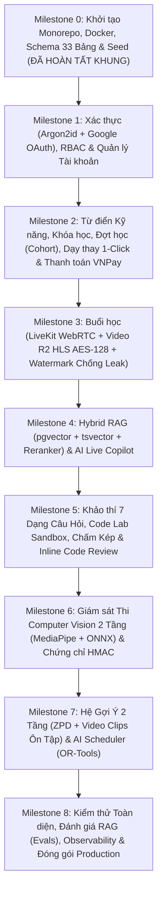

# 05. Lộ Trình Triển Khai Chi Tiết Từng Giai Đoạn (Implementation Roadmap)

> **Tài liệu này chia quá trình xây dựng hệ thống thành 9 Milestone tuần tự.** Mỗi Milestone có phạm vi rõ ràng, danh sách tệp cần hoàn thiện và tiêu chí nghiệm thu cụ thể để bạn hoặc AI Coding Agent có thể triển khai từng bước chắc chắn mà không bị ngợp.

---

## Tổng Quan 9 Milestones

---

## Chi Tiết Từng Milestone & Tiêu Chí Nghiệm Thu

### Milestone 0: Khởi Tạo Hạ Tầng, Monorepo & Lược Đồ CSDL 33 Bảng *(Đã dựng khung sườn)*
- **Hạng mục thực hiện:**
  - Cấu trúc Monorepo (`apps/api`, `apps/ai-service`, `apps/web`, `infra`, `docs`).
  - `docker-compose.dev.yml` chạy PostgreSQL 16 (`pgvector/pgvector:pg16`) và Redis 7 (`redis:7-alpine`).
  - Định nghĩa đầy đủ 33 bảng trong `apps/api/src/db/migrations/0000_baseline_v2.sql` và `apps/api/src/db/schema/`.
  - Hợp đồng dữ liệu TypeScript tại `apps/web/src/shared/types/contracts.ts`.
- **Cách kiểm tra nghiệm thu:**
  - Chạy `npm run dev:infra` lên container Postgres và Redis trạng thái `healthy`.
  - Chạy file SQL migration `0000_baseline_v2.sql` tạo thành công 33 bảng và các chỉ mục HNSW/GIN/GiST.
  - Chạy `npm run db:seed` tạo tài khoản Admin mặc định (`admin@edutech.vn` / `Admin@2026!`).

---

### Milestone 1: Xác Thực Tinh Gọn, Phân Quyền 3 Tầng & Onboarding
- **Phía Backend (`apps/api/src/modules/auth/`, `users/`):**
  - Đăng ký học viên (`Argon2id`), xác thực email, quên/đặt lại mật khẩu.
  - Đăng nhập Email/Password + Đăng nhập 1 chạm Google OAuth 2.0 (tự động gộp tài khoản trùng email).
  - Cơ chế xoay vòng Refresh Token trong Redis + `HttpOnly Cookie`.
  - API Admin tạo tài khoản Giảng viên (`STAFF` / `GUEST`) và gửi email mời.
  - API lưu mục tiêu nghề nghiệp, kết quả khảo sát đầu vào và ảnh khuôn mặt tham chiếu (`face_reference_r2_key` + `face_embedding`).
- **Phía Frontend (`apps/web/src/features/auth/`, `onboarding/`):**
  - Các trang `/login`, `/register`, `/forgot-password`, `/reset-password/:token`, `/verify-email`.
  - Trang `/onboarding` 4 bước (Mục tiêu -> Quiz 5 câu -> Chụp ảnh khuôn mặt -> Kết quả năng lực ban đầu).

---

### Milestone 2: Danh Mục Kỹ Năng, Khóa Học, Đợt Học (`Cohort`), Dạy Thay 1-Click & Thanh Toán VNPay
- **Phía Backend (`apps/api/src/modules/courses/`, `cohorts/`, `orders/`):**
  - CRUD Danh mục (`categories`), Từ điển Kỹ năng (`skills`), Khóa học (`courses`, `course_skills`, `syllabus_template`).
  - Mở Đợt học (`cohorts`) tự động sinh danh sách `class_sessions` từ `syllabus_template`.
  - Gán đội ngũ giảng dạy (`cohort_instructors`: `INSTRUCTOR`, `TA`, `GUEST`).
  - API **Đổi người dạy thay 1-Click** (`PATCH /api/v1/admin/sessions/:id/host`) kiểm tra chống trùng giờ bằng `EXCLUDE USING gist`.
  - Luồng thanh toán trực tiếp qua VNPay (`HMAC-SHA512`) có khóa lũy đẳng `idempotency_key` và xử lý IPN nguyên tử `FOR UPDATE`.
- **Phía Frontend (`apps/web/src/features/catalog/`, `checkout/`, `admin/`):**
  - Trang chủ `/`, Danh mục `/courses`, Chi tiết khóa học `/courses/:slug` (có cảnh báo trùng lịch học nếu học viên đang học lớp khác), Hồ sơ giảng viên `/instructors/:id`.
  - Trang thanh toán trực tiếp `/checkout/:cohortCode` và kết quả `/checkout/result`.
  - Giao diện Admin quản lý khóa học, kỹ năng, đợt học và đổi người dạy thay 1-click.

---

### Milestone 3: Không Gian Lớp Học, Phòng LiveKit WebRTC & Trình Phát Video HLS Chống Leak
- **Phía Backend & Worker (`apps/api/src/modules/sessions/`, `apps/ai-service/src/worker/`):**
  - Cấp LiveKit Token phân quyền theo vai trò (`host_instructor_id` / `TA` / `ADMIN` làm Host; `STUDENT` làm người học).
  - Xử lý bắt đầu/kết thúc buổi Live: tự động lọc bỏ các phiên thử nghiệm `< 5 phút`.
  - Pipeline xử lý Video quay sẵn và Replay buổi Live sang **HLS mã hóa AES-128** lưu trên Cloudflare R2.
  - Ghi nhận tiến độ xem video (`session_progress`) mỗi 15 giây, tự động hoàn thành khi xem đạt $\ge 90\%$.
- **Phía Frontend (`apps/web/src/features/cohort-workspace/`, `session/`, `live-room/`):**
  - Dashboard học viên `/app`, Không gian đợt học `/app/cohorts/:cohortId` (6 Tab).
  - Trang buổi học `/app/cohorts/:cohortId/sessions/:sessionId` với trình phát `SecureHlsPlayer` tích hợp **Dynamic Canvas Watermark** di chuyển mỗi 12 giây và `MutationObserver`.
  - Phòng học trực tuyến `/live/:sessionId` (Pre-join Lobby, Sân khấu chính, Chat, Hỏi đáp bình chọn, Điểm danh).

---

### Milestone 4: Kho Tri Thức Hybrid RAG (Có Citations Bấm Được) & AI Live Copilot
- **Phía AI Service (`apps/ai-service/src/rag/`, `live_copilot/`):**
  - Bóc tách an toàn PDF/DOCX/PPTX và phụ đề `.vtt` thành các `knowledge_chunks` kèm `start_sec`, `end_sec`, `page_number`.
  - Cơ chế xóa và lập chỉ mục lại khi giảng viên thay thế video quay sẵn mới cho buổi học.
  - Truy vấn **Hybrid Search (`pgvector` HNSW + `tsvector` GIN + RRF)** + **Cross-Encoder Reranker**.
  - Trợ lý Tư vấn Tuyển sinh (`/advisor` - `visibility = 'PUBLIC'`) và Trợ giảng Buổi học (`SESSION_TUTOR` - cô lập theo `cohort_id`).
  - AI Live Copilot: Phiên âm trực tiếp (`Silero VAD` + `faster-whisper`), nút **"Tóm tắt 10 phút vừa qua"** cho người vào muộn, gom cụm câu hỏi cho giảng viên, và sinh bản tóm tắt + câu hỏi ôn tập sau buổi học.
  - Tự động sinh câu trả lời nháp (`is_ai_generated = TRUE`) cho các chủ đề thảo luận của học viên, chờ giảng viên/TA bấm xác nhận.

---

### Milestone 5: Khảo Thí 7 Dạng Câu Hỏi, Code Lab Sandbox, Chấm Điểm Kép & Inline Code Review
- **Phía Backend & AI Service (`apps/api/src/modules/assessments/`, `code-sandbox/`):**
  - Trình tạo đề thi hỗ trợ đủ 7 dạng câu hỏi (`SINGLE_CHOICE`, `MULTI_SELECT`, `TRUE_FALSE`, `SHORT_ANSWER`, `ESSAY`, `FILE_SUBMISSION`, `CODING`), bắt buộc gán `skill_id`.
  - Công cụ AI tạo câu hỏi nháp từ bản ghi lời giảng của buổi học.
  - Endpoint chạy code cô lập `POST /api/v1/code/run`.
  - Chấm điểm tự động kết hợp hàng đợi chấm tay có **AI gợi ý điểm + nhận xét theo rubric** và **nhận xét từng dòng code (`review_comments JSONB`)**.
- **Phía Frontend (`apps/web/src/features/assessments/`, `code-lab/`, `code-review/`, `teach/`):**
  - Phòng làm bài kiểm tra trực tuyến `/app/assessments/:id/attempts/:attemptId` (lưu tự động, hỗ trợ thu âm bài nói và trình soạn thảo Monaco Editor).
  - Phòng thực hành lập trình `/app/code` (Bài lập trình trong khóa + Sân chơi Scratchpad lưu `localStorage`).
  - Bàn chấm bài của Giảng viên `/teach/grading` và trang xem chi tiết nhận xét code của Học viên `/app/submissions/:answerId`.

---

### Milestone 6: Giám Sát Thi Computer Vision 2 Tầng & Chứng Chỉ Số Ký HMAC
- **Phía Frontend & AI Service (`apps/web/src/features/proctoring/`, `apps/ai-service/src/proctoring_cv/`):**
  - Luồng kiểm tra 4 bước trước khi vào thi cuối khóa `/app/exams/:assessmentId` (kiểm tra webcam, đối sánh khuôn mặt **ArcFace 512d**, cam kết quy chế, khóa Fullscreen).
  - Giám sát Tầng 1 trên trình duyệt bằng MediaPipe + Giám sát Tầng 2 trên máy chủ bằng **YOLO11n ONNX**.
  - Bàn hậu kiểm bằng chứng thi cho Giảng viên `/teach/proctoring/:attemptId` với dòng thời gian ảnh chụp và 3 nút phán quyết (`CLEAN`, `CONFIRMED_CHEAT`, `CLEARED_BY_INSTRUCTOR`).
  - Cấp phát chứng chỉ số ký `HMAC-SHA256` kèm mã QR và trang tra cứu công khai `/verify/:certificateCode`.

---

### Milestone 7: Hệ Gợi Ý Năng Lực 2 Tầng (RecSys) & Bộ Xếp Lịch Tự Động AI Scheduler
- **Phía AI Service & Backend:**
  - Cập nhật `student_skill_states` sau mỗi bài kiểm tra.
  - **Macro RecSys (ZPD):** Gợi ý khóa học tiếp theo kèm giải thích trên Dashboard và trang `/app/path` (vẽ đồ thị kỹ năng tiên quyết DAG).
  - **Micro RecSys (Remedial):** Gợi ý chính xác đoạn video (`start_sec` – `end_sec`) và trang PDF cần xem lại ngay trên trang kết quả bài thi.
  - **AI Scheduler (`/admin/scheduler`):** Chuyển đổi yêu cầu ngôn ngữ tự nhiên tiếng Việt thành ràng buộc và giải lịch tự động bằng **Google OR-Tools CP-SAT**.
  - **Phân tích sư phạm cho Giảng viên:** Biểu đồ nhiệt độ khó hiểu (`Confusion Heatmap`) dọc theo thanh thời gian video bài giảng.

---

### Milestone 8: Kiểm Toán Chất Lượng, Đánh Giá RAG (Evals), Observability & Đóng Gói Production
- **Hạng mục thực hiện:**
  - Trang Giám sát AI cho Admin (`/admin/ai`): Thống kê Token, chi phí VND, độ trễ p50/p95, tỷ lệ fallback Gemini ↔ vLLM, liên kết Langfuse Trace.
  - Bộ kiểm thử chất lượng RAG tự động (`apps/ai-service/evals/run_rag_eval.py`) trên bộ 50 câu hỏi tiếng Việt chuẩn (`golden_rag_vi.json`), đo 3 chỉ số: *Faithfulness*, *Answer Relevancy*, *Context Recall*.
  - Kiểm toán toàn bộ giao diện theo Checklist: Loading Skeleton, Empty State, Error State kèm `requestId`, Responsive Mobile/Desktop, và kiểm tra không rò rỉ `grading_config`.

